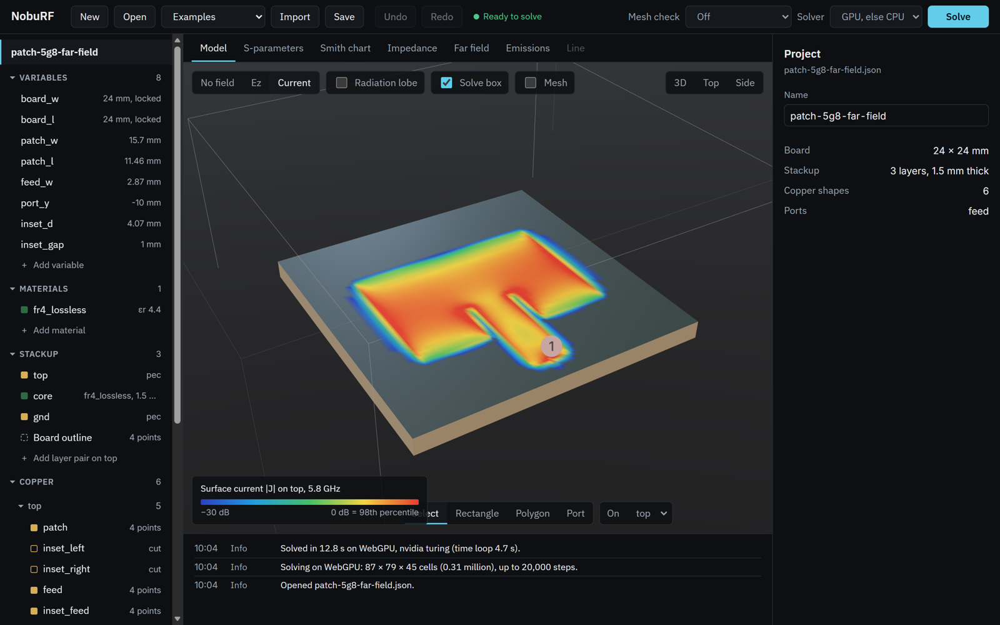
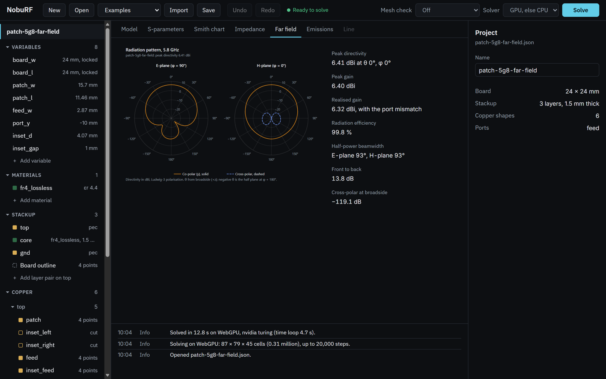

# NobuRF

**Maxwell's equations, solved in a browser tab.**

NobuRF is a 3D electromagnetic field solver for antennas and printed circuit boards. It runs the
finite-difference time-domain (FDTD) method on your own GPU through WebGPU, in Chrome or Edge. Draw a board or
import one, put a port on it, and read S-parameters, impedance, the radiation pattern and the fields on the
copper.

[Open the workbench](https://noburf.llom.party/app/) · [Website](https://noburf.llom.party/) ·
[Validation report](docs/validation.md) · [Workbench guide](docs/workbench.md) · [All docs](docs/README.md)



## What it does

- **Build or import a board.** Variables with units, a layer stackup, copper polygons, cuts and vias. Gerber, DXF
  and STEP import.
- **Ports.** Lumped ports, SMA edge and coax probe feeds, differential pairs, and port de-embedding with a
  calibration kit built from the project.
- **Results.** |S|, Smith chart, input impedance, far-field cuts with gain and efficiency, near-field emission
  scans, and current and field maps on the model. Results export as Touchstone and CSV.
- **A check on every answer.** An opt-in mesh-convergence error bar, passivity and reciprocity checks, and a
  validated range that each solve reports against.
- **The same solver from the command line.** `noburf` solves a JSON project file and writes a Touchstone file
  plus a `result.json` that records how the answer was made.
- **AI-directed design.** A language model picks the strategy, and the solver and an optimizer find the numbers,
  with hard spend caps on every model call. See [docs/design-agent.md](docs/design-agent.md).



## How far to trust it

Every claim below has a script and data in this repository. The [validation report](docs/validation.md) lists
what disagrees, too.

- **Against exact answers.** Cavity modes land within 0.014 to 0.23 % of the analytic frequency, depending on
  the grid, with second-order convergence. The kernels match the exact discrete Yee solution to a few parts per
  million.
- **Against another solver.** On the demo patch antenna, with both codes at 0.25 mm on the copper, the resonance
  is 5.30 GHz against openEMS's 5.34 GHz (edge-fed), and 5.47 GHz for both (inset-fed). Both are FDTD codes, so
  this checks the implementation, not the method.
- **Against textbooks.** The [textbook exam](docs/textbook-exam.md) grades NobuRF on 14 standard problems, and
  it publishes the rows that fail.
- **Not checked yet.** A fabricated board on a network analyzer, and boundary reflection at oblique incidence.

## Run it

You need Node 20 or later, and Chrome or Edge for WebGPU. Without a GPU, everything falls back to a CPU
reference solver, only slower.

```bash
npm install
npm run dev:web
# then open http://localhost:5173/workbench.html
```

From the command line:

```bash
npm run noburf -- solve examples/patch-5g8.json          # the GPU when there is one, else the CPU
npm run noburf -- solve examples/patch-5g8.json --gpu    # the GPU or fail
```

The project format and every command are in [docs/project-file.md](docs/project-file.md).

## Tests

```bash
npm run typecheck
SKIP_SLOW=1 npm test     # about two minutes; drop SKIP_SLOW for the slow solver tests
npm run test:gpu:node    # every WGSL kernel against the CPU reference, through Dawn
```

`scripts/ci_local.sh` runs the full set that a pull request has to pass.

## How it works

- **Yee grid with graded mesh lines.** Mesh lines snap to copper edges and grade away from them. Materials are
  set per Yee edge, so copper stays zero-thickness and dielectric interfaces get the averaged permittivity.
- **Conformal copper.** Curved and slanted copper, and thin curved sheets, use sub-cell corrections instead of a
  staircase.
- **Open boundaries.** A convolutional PML on each face. Its reflection at normal incidence is about −84 dB.
- **Losses.** Copper loss that rises with the square root of frequency, and dielectrics with loss that varies
  with frequency (Djordjevic–Sarkar).
- **Run length.** Each solve runs until the field energy has fallen 50 dB from its peak.
- **GPU.** WGSL compute kernels. The step counter lives on the GPU, and fields are read back only at checks and
  at the end.

## Layout

```
src/engine/     solver: FDTD kernels (WGSL + CPU reference), ports, PML, mesh, far field, de-embedding
src/project/    project schema, units, edits, rasterizing a project onto the grid
src/workbench/  the browser app
src/import/     Gerber, DXF and STEP import
src/design/     AI-directed design: goals, model clients, spend caps, race replay
scripts/        noburf CLI, design agent, validation and self-verification scripts
examples/       project files, including textbook and published benchmarks
docs/           guides and the validation report
site/           the website
```

## Keys

The AI features read provider keys from environment variables only (see `.env.example`). `.env` is gitignored.
Never commit a key or paste one into an issue.

## License

NobuRF is free software under the [GNU Affero General Public License, version 3](LICENSE). If you run a changed
version as a service, the AGPL asks you to offer your users its source. Contributions are accepted under a
[Contributor License Agreement](CLA.md), which lets the owner offer other license terms as well.

---

NobuRF is an independent project. It is not affiliated with or endorsed by any commercial solver vendor.
