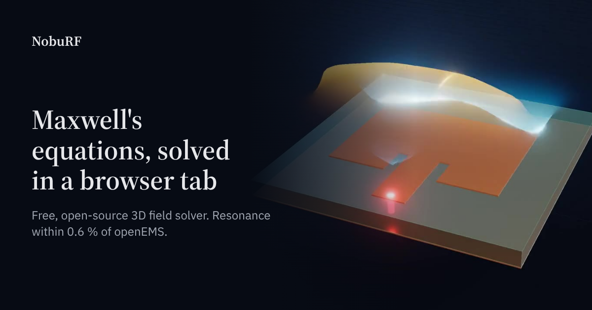
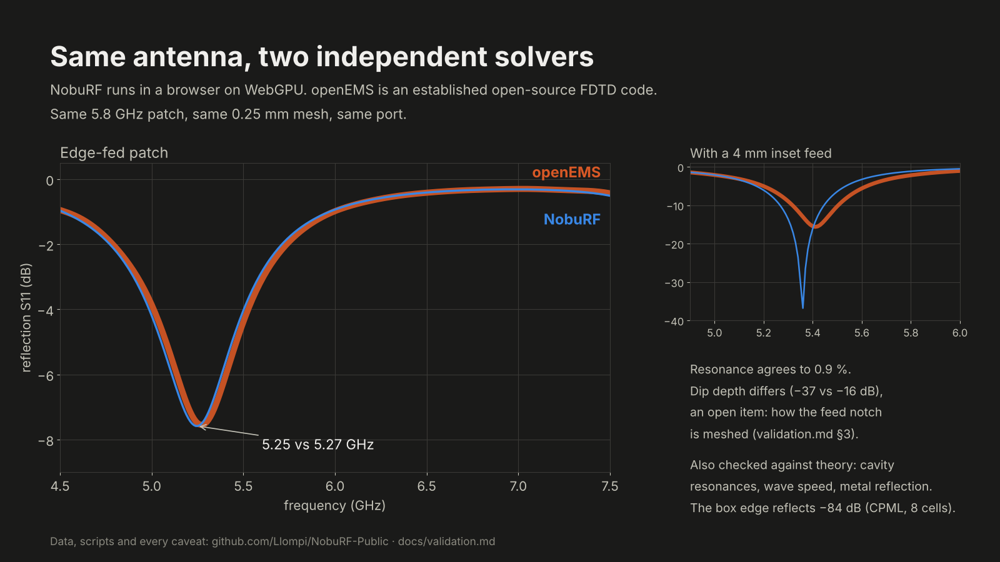

<p align="center"></p>

# NobuRF

A 3D field solver for antennas. It runs on your GPU through WebGPU, in Chrome or Edge.
On a laptop GTX 1660 Ti, a 5.8 GHz patch antenna (66 × 66 × 48 cells at 0.5 mm, run until the field energy has
fallen 50 dB) solved in 1.9 s, about 3 s from click to results.

[Website](https://noburf.llom.party/) · [Workbench guide](docs/workbench.md) · [Validation report](docs/validation.md) · [All docs](docs/README.md) · [Run it](#quick-start) · [Roadmap](https://noburf.llom.party/#roadmap)

<!-- paste the user-attachments video URL here -->

Checked against openEMS on the same patch and port at the same 0.25 mm resolution (a uniform grid here, a graded
mesh in openEMS), the resonant frequency agrees to 0.4 % (edge-fed) and 0.9 % (inset-fed). The [validation report](docs/validation.md) also lists what doesn't agree yet.

For the Kimi K3.1 Pro on Cerebras hackathon, Kimi tunes the antenna through the solver's tool API.
<!-- after the race: Same model on Cerebras and on a GPU provider: ⟨T_c⟩ s against ⟨T_g⟩ s to a match. [Video](⟨X post link⟩), [run logs](launch/runs/). -->

NobuRF is independent of any commercial solver vendor.

## Validation

How accurate is it? See **[docs/validation.md](docs/validation.md)**: cavity modes within 0.014 to 0.23 % of
the analytic answer, depending on the grid, and the demo patch against openEMS (resonance within 1 % at the same resolution), with the known
limits and a roadmap.

## Solver backend: project files and the `noburf` CLI

The solver also runs outside the demo. A JSON project file describes the board
(variables with units, stackup, copper polygons, a port, per-face boundaries,
mesh and band); `noburf` meshes it, solves until the field energy has decayed,
and writes a Touchstone file plus a `result.json` with full provenance.

```bash
npm run noburf -- solve examples/patch-5g8.json          # GPU when there is one, else the CPU reference
npm run noburf -- solve examples/patch-5g8.json --cpu    # CPU reference
npm run noburf -- solve examples/patch-5g8.json --gpu    # GPU or fail
```

By default the solve runs the WebGPU kernels through Dawn (the optional
`webgpu` package) when it finds a WebGPU adapter, and prints why when it falls
back to the CPU reference. `--gpu` makes a missing GPU an error.

On a GTX 1660 Ti laptop the example solves in 2.0 s on the GPU and 47 s on the
CPU, with the same result. Format: [docs/project-file.md](docs/project-file.md).
Benchmarks: [bench/README.md](bench/README.md).



## Quick start

```bash
npm install
npm run dev          # Vite on :5173 + bridge on :8787
# open http://localhost:5173 in Chrome or Edge (WebGPU)
# or http://localhost:5173/workbench.html for the workbench: build or import a
# board, set ports and materials, solve, and plot |S|, the Smith chart, Z_in,
# far-field cuts and field maps (guide: docs/workbench.md)
```

Then, from another terminal:

```bash
curl -s localhost:8787/api/state | head -c 400
curl -s -XPOST localhost:8787/api/apply_edit -H 'content-type: application/json' \
  -d '{"inset_depth_mm": 4}'
npm run roundtrip    # plan test 3: edit -> browser solve -> telemetry, < 500 ms budget
```

Open `http://localhost:5173/selftest.html` for the in-browser GPU checks on your
own GPU (this is the place to read real solve times).

## Tests

| Command | What it checks |
| --- | --- |
| `npm test` | Node tests (vitest): solver stability, PEC sheet, cavity resonance vs analytic, CPML reflection, lossy propagation, energy stop, port DFT and port kinds, project-file parsing and meshing, the CLI (with golden values), geometry validation, token budget, rate meter, bridge (fake browser). `SKIP_SLOW=1` skips the three slow ones (3D CPML absorption, energy-stop equivalence, full patch solve). `tests/gpu_cli.test.ts` compares `noburf --gpu` with `noburf --cpu` and is skipped when no WebGPU adapter exists; set `VK_ICD_FILENAMES=/opt/lavapipe/lvp_icd.json` to use a software GPU |
| `npm run test:gpu:node` | Every WGSL kernel vs the CPU reference through Dawn in Node, including multi-row dispatches |
| `npm run bench:wgsl` | Kernel throughput (Mcells/s, GB/s) with a correctness check per grid |
| `npm run test:gpu` | Headless Chromium + WebGPU: GPU vs CPU parity on the full grid, stability, PEC, full baseline solve |
| `npm run roundtrip` | Live bridge round trip with a real browser tab open |
| `npm run cerebras:ping` | Cerebras key + model check (free-tier model before kickoff) |

## Layout

```
src/engine/   types.ts (contracts) · config.ts (grid, stability checks) · geometry.ts (DSL + edits)
              voxelize.ts · fdtd3d.ts (WebGPU) · fdtd_cpu.ts (reference) · shaders/*.wgsl
              source.ts · port_dft.ts (Z_in, S11) · telemetry.ts · sim_runner.ts
              cpml.ts (boundary) · mesh.ts (graded lines) · energy_stop.ts
              huygens_box.ts · near_to_far.ts (far field) · plane_dft.ts (field maps)
src/workbench/ workbench.html app: store.ts (document, undo, unsaved state) · tree · inspector
              model_view.ts (3D) · solve.ts + solve_worker.ts · results.ts · import_dialog.ts
src/import/   Gerber, DXF and STEP to project files
src/design/   AI-directed design: design file, goal, strategist, LLM clients, spend caps, race replay
src/viewer/   scene3d.ts (Three.js) · s11_chart.ts · smith_chart.ts · pattern_plot.ts
src/main.ts   page wiring · src/selftest.ts  GPU self-test page
server/       bridge.ts (HTTP + WebSocket) · rate_meter.ts (100 RPM / 100K TPM guard)
openclaw/     tool contract + placeholders, built at kickoff
src/project/  schema.ts · expression.ts (units) · resolve.ts · edits.ts · rasterise.ts (project -> voxels)
src/node/     gpu_device.ts (headless WebGPU via Dawn) · raw-import hooks
scripts/      noburf.ts (CLI) · design.ts + design-mcp.mjs (design agent) · validate/ (analytic, patch vs openEMS,
              benchmarks) · ci_local.sh · gpu_selftest · bridge_roundtrip · cpu_solve · cerebras_ping
docs/         see docs/README.md · site/  landing page · launch/  launch kit
bench/        webgpu_node/ (WGSL benchmark, Node selftest) · cuda/ (CUDA reference kernels, Colab notebook)
```

## How the solver works

- **Grid:** 64 × 64 × 48 cubic cells of 0.5 mm (196k cells), Courant 0.99/√3.
  The demo antenna is a 5.8 GHz patch on 1.5 mm FR‑4 (εr 4.4), which fits this
  grid with ≥ 20 cells per wavelength. A 2.4 GHz patch would need ~2.5× the box.
- **Materials per Yee edge, not per cell.** Copper zeroes only tangential E on
  its plane, so sheets stay zero-thickness (a per-cell mask silently makes the
  3-cell substrate 33 % thinner). Interface edges get the averaged εr.
- **Port:** a 50 Ω resistive voltage source spread over the 3 Ez cells under the
  feed (semi-implicit lumped element). V is the line integral of E across the
  substrate; I is the Ampère loop of H around the port. The resistor also damps
  the patch, so it rings down faster.
- **Excitation:** Gaussian-modulated sine covering 4.5–7.5 GHz.
- **Boundary:** an 8-cell convolutional PML (CPML) on every face, with its auxiliary
  fields stored only in the boundary slabs. Normal-incidence reflection is about
  −84 dB across 4.5–7.5 GHz (the graded sponge it replaced measured −21 dB).
- **Loss:** per-edge decay and curl coefficients; a substrate loss tangent is applied
  as a conductivity exact at the target frequency, as openEMS does.
- **Run length:** fixed (3000 steps) for the live demo, or until the field energy
  is 50 dB below its peak (`ENERGY_STOP_RUN`).
- **Per step:** H pass, CPML H passes, E pass, CPML E passes, one-workgroup port
  pass, all in one compute pass.
  The step counter lives on the GPU; a run is split into submits of at most 250
  steps (see Windows notes) and read back once at the end.
- **Post-processing:** DFT at 121 frequencies with true half-step sample times,
  Z_in = V/I, S11 = 20 log10 |(Z − 50)/(Z + 50)|, then a ~300-token telemetry summary.

### Deviations from the Gemini plan, and why

1. **3000 steps, not 450.** At dt ≈ 0.95 ps, 450 steps is 0.43 ns, about 2.5
   periods at 5.8 GHz. A loaded patch rings for several ns. With 3000 steps the
   resonance frequency is converged (same f0 at 12000 steps); the dip depth of a
   very good match still moves a few dB (−16.5 vs −19.4 dB). Telemetry warns with
   `deep_dip` once a dip goes below −20 dB, where depth is no longer converged.
   A dip above that line (−16.5 dB with a 4 mm inset) gets no warning; at
   3000 steps the one case checked reads shallower than the converged run, not deeper.
2. **A CPML, not a sponge.** The plan's sponge (multiply the old field by 0.85)
   is unstable near the Courant limit. A matched-conductivity sponge was stable
   but reflected −21 dB; it has since been replaced by a CPML.
3. **No per-step uniform `step`.** `queue.writeBuffer` runs before the whole
   submit, so batching 50 steps with a uniform step index gives all 50 the same
   value. The counter is a storage buffer advanced by the port kernel.
4. **Packed buffers.** E, H, eDecay and eCurl are one buffer each with x/y/z blocks.
   Separate Ex…Hz + materials + history needs 10 storage bindings; WebGPU's
   default limit is 8.
5. **Resistive port + modulated pulse** instead of a soft DC Gaussian at one
   voxel: a DC pulse leaves static charge on the patch that never decays, and a
   1-cell V probe misses most of the substrate voltage.

### Measured so far (CPU reference, CPML, 3000 steps)

| Geometry | f0 (GHz) | S11 min (dB) |
| --- | --- | --- |
| Baseline, edge-fed, L 12.4 mm | 5.36 | −6.3 |
| Inset 4 mm | 5.53 | −16.5 |

Textbook (transmission-line model) TM010 for L 12.4 mm: 5.54 GHz; openEMS at
0.25 mm gives 5.27 GHz, so the textbook model is the one that is off (see
validation.md section 4.1). The slow test in `tests/physics.test.ts` requires
the solver to stay within 5 % of the textbook value.

**Real GPU (a laptop with a GTX 1660 Ti Max-Q, Edge 157, Nov 19, before the CPML):** self-test 6/6 PASS,
GPU matches the CPU reference to 1e-6, full 3000-step solve **552 ms** (~1,070 Mcells/s).
The kernels alone, headless through Dawn after the CPML, run at 2,792 Mcells/s on 1.6M cells
(`npm run bench:wgsl`).
`npm run roundtrip`: worst edit round trip **455 ms** against the 500 ms budget, which is
only ~10 % margin. Levers if it gets tight: fewer steps (2000 keeps f0, loses some dip
depth), skip the animated slice readbacks for agent runs, or f16 fields.

### Windows notes

- Launch Edge with `--force_high_performance_gpu` (or set Edge to "High performance"
  in Windows Settings → Display → Graphics). Chrome/Edge ignore `powerPreference` on
  Windows and otherwise pick the integrated Radeon GPU.
- Runs are split into submits of at most 250 steps, so no single GPU job approaches
  the ~2 s Windows watchdog (TDR), which on the iGPU used to kill the device mid-solve.

## Honesty notes for the demo

- This is a coarse full-wave solve (0.5 mm cells, 3-cell substrate, lossless
  FR‑4 in the demo patch). Absolute f0 and S11 are approximate; trends
  and the tuning story are real. The UI says so.
- Each solve takes about half a second on a GPU (measured before the CPML), not per-frame. The agent's
  speed is the Cerebras story; the solver just has to keep up.

## Secrets

The Cerebras key is read from `CEREBRAS_API_KEY` only (`.env` is gitignored, see
`.env.example`). Never paste it in chat, commits or the demo video.
