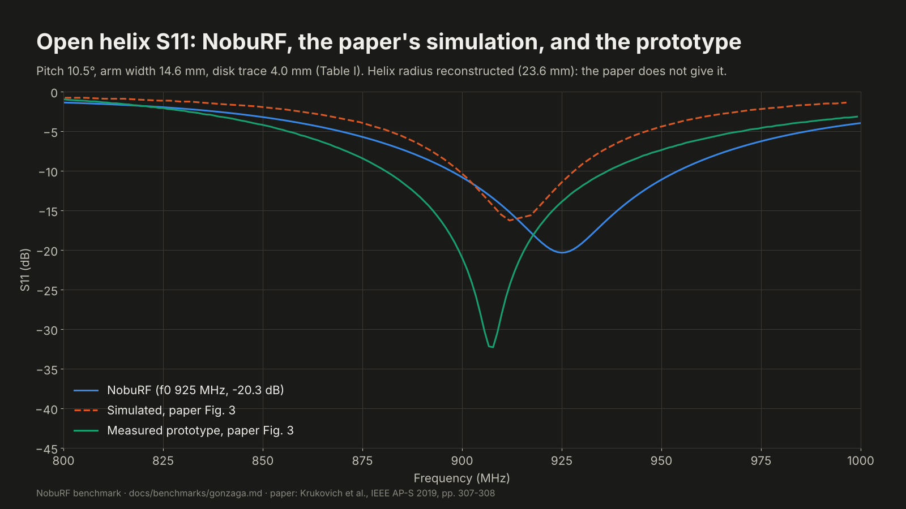
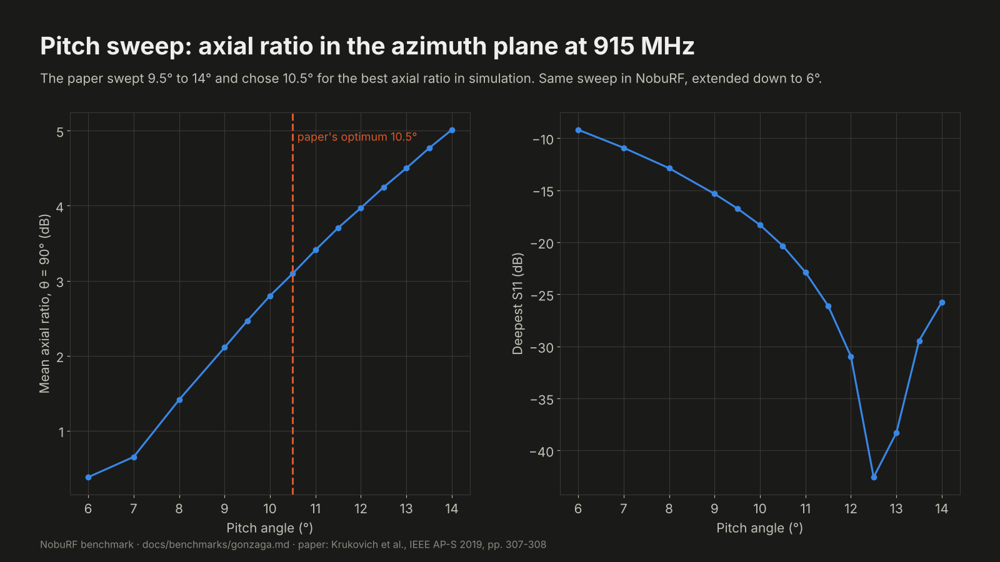
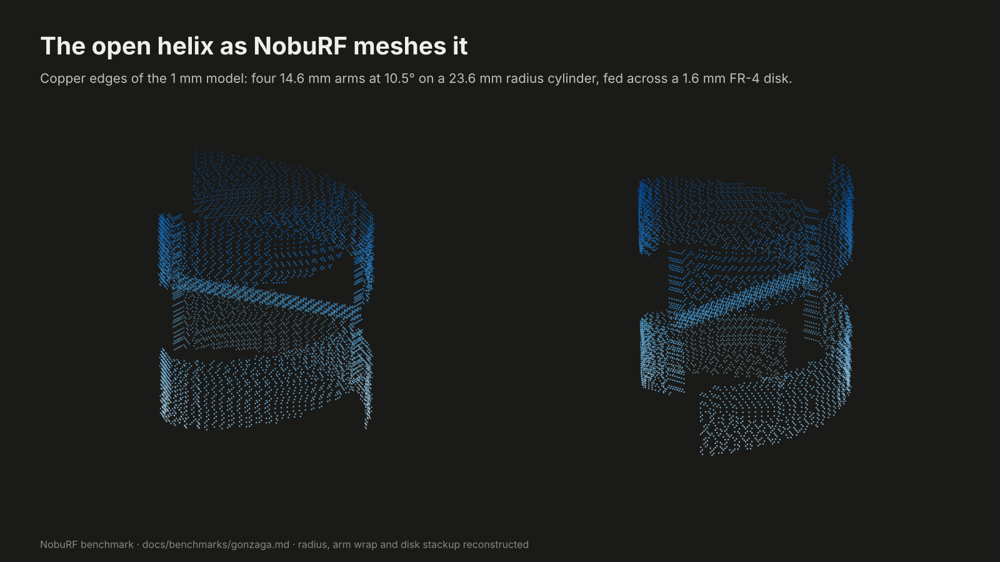

# Gonzaga open-helix element (IEEE AP-S 2019)

**Paper:** H. Krukovich, B. Bladow, J. Varness, S. Schennum, "Center-Fed
Circularly Polarized Omnidirectional Open-Helical Element Optimization",
IEEE AP-S 2019, pp. 307–308. A Gonzaga University senior-design antenna: two
dipoles wrapped round a cylinder, so the element radiates circular
polarisation equally in every azimuth direction. The authors optimised it in
a commercial finite-element solver by parametric sweeps, then built and measured it at 915 MHz.

This is NobuRF's first non-planar benchmark. The point is to see the solver
take a curved, wrapped 3D conductor, which the patch and microstrip cases do
not test. It is **not** an exact reproduction: the paper does not give the
size of the antenna (see [What the paper gives](#what-the-paper-gives)), so
part of the geometry is reconstructed.



## Results at a glance

NobuRF on the 1 mm mesh, pitch 10.5°, arm width 14.6 mm (71.2 mm long), disk trace 4.0 mm (the
paper's Table I optimum), helix radius 23.6 mm (reconstructed), at 915 MHz:

| Quantity | NobuRF | Paper, simulated | Paper, measured | Reading |
| --- | --- | --- | --- | --- |
| Resonance (S11 minimum) | 925 MHz | 915 MHz | 907 MHz | Set by the reconstructed radius, so not evidence either way |
| Deepest S11 | −20.3 dB | −16.3 dB | −32.6 dB | Dip depth depends on the feed and is not converged in NobuRF (−22 to −18 dB across meshes) |
| −10 dB bandwidth | 56 MHz (6.1 %) | 29.0 MHz (3.2 %) | 55.9 MHz (6.2 %) | NobuRF matches the prototype, and is about twice the paper's simulation |
| Co-polar gain, azimuth plane | 1.40 dBi RHCP | ≈ 2.57 dBi (measured + 1.08) | 1.49 dBi | NobuRF within 0.1 dB of measured |
| Azimuth gain ripple | 0.77 dB | 0.68 dB | 0.90 dB | Between the two |
| Elevation half-power points | ±45.2° | ±45° | ±42.5° | Not a test: every NobuRF run gives ±45°, even the mistuned 17 mm radius, because it is the short-dipole pattern |
| Radiation efficiency | 95 % | 98 % | 86 % | FR-4 disk (tan δ 0.02) and copper loss included |
| Cross-polar rejection, azimuth (worst) | 13.6 dB | > 22.6 dB | 11.9 dB | At this radius 10.5° is not the axial-ratio optimum in NobuRF; see the sweep |
| Mean axial ratio, azimuth | 3.1 dB | ≈ 0 dB (the design goal) | — | Same |

Simulated and measured numbers come from the paper's text; the S11 curves and the
simulated bandwidth were read off its Fig. 3 by pixel colour
([data/gonzaga/fig3_digitised.json](data/gonzaga/fig3_digitised.json)). The
Simulated azimuth gain is inferred from "the measured gain was 1.08 dB lower".

Two things stand out:

- **Bandwidth and gain land on the prototype, not on the paper's simulation.** NobuRF's −10 dB
  band (56 MHz) and azimuth gain (1.40 dBi) are within 1 % and 0.1 dB of the
  measured antenna. The paper's simulation has half that bandwidth and 1.1 dB more
  gain, and the authors partly blame the foam support disks, which the paper's simulation left
  out. NobuRF leaves them out too. With the geometry partly reconstructed
  this is a lead, not a finding. 2.57 dBi of RHCP gain from an omni with
  ±45° beamwidth is also above what a short dipole gives (about 1.8 to 2 dBi
  total at that beamwidth), so the simulated gain figure may include something we
  can't see from the paper.
- **The pitch angle for circular polarisation comes out lower than the
  paper's.** See the next section.

## Pitch sweep: where circular polarisation peaks



The paper's main optimisation swept the pitch angle α from 9.5° to 14° in
0.25° steps, looking for an axial ratio of 0 dB, and chose 10.5°. NobuRF
over that range and down to 6° (0.5° steps, 1° below 9°), radius fixed at
23.6 mm:

| α (°) | 6 | 7 | 8 | 9 | 9.5 | 10 | 10.5 | 11 | 11.5 | 12 | 12.5 | 13 | 13.5 | 14 |
| --- | --- | --- | --- | --- | --- | --- | --- | --- | --- | --- | --- | --- | --- | --- |
| Mean AR at 915 MHz (dB) | 0.38 | 0.65 | 1.41 | 2.11 | 2.47 | 2.80 | 3.10 | 3.41 | 3.70 | 3.97 | 4.25 | 4.50 | 4.77 | 5.01 |
| Worst XPR, azimuth (dB) | 27.3 | 23.1 | 18.9 | 16.3 | 15.2 | 14.3 | 13.6 | 12.9 | 12.3 | 11.8 | 11.3 | 10.9 | 10.5 | 10.1 |
| f0 (MHz) | 888 | 899 | 909 | 916 | 920 | 923 | 925 | 928 | 930 | 932 | 933 | 934 | 935 | 936 |
| Deepest S11 (dB) | −9.2 | −10.9 | −12.9 | −15.4 | −16.8 | −18.3 | −20.3 | −22.9 | −26.1 | −31.0 | −42.6 | −38.3 | −29.5 | −25.8 |

The −42.6 dB at 12.5° is where Z_in passes through 50.7 + j0.2 Ω; a dip that
deep only says the match is exact there, and its depth is not meaningful
(see the mesh check).

The axial ratio falls steadily as α decreases and reaches 0.4 dB at 6°.
The paper-like cross-polar rejection (> 22.6 dB) needs α ≈ 7° at this radius.
The match improves the other way, so axial ratio and S11 pull against each
other, which is why the paper also tuned the disk trace width.

Why the optimum differs, and what would settle it:

1. **The optimum depends on the radius, which we had to guess.** For a
   helix, the vertical (electric dipole) and horizontal (loop) parts of the
   current radiate equal fields when C = 2λ tan α (Wheeler 1947, the paper's
   reference [2]). Circumference and pitch trade against each other, so a
   different radius moves the best α. Here the radius was chosen to put the
   resonance near 915 MHz with a 170° arm wrap, and both of those are
   guesses.
2. **Wheeler's rule and NobuRF disagree in direction.** At C = 148 mm
   Wheeler's rule asks for α ≈ 12.7°, while NobuRF's axial ratio is still
   falling at 6°, the lowest angle run. Wheeler assumes a uniform travelling current on a thin wire. These
   arms are wide strips (14.6 mm) carrying a dipole's standing-wave current,
   largest at the feed, so the rule is only a guide. An independent solver on
   the same reconstructed geometry (openEMS) would tell a NobuRF error apart
   from a geometry or physics difference. The circular-polarisation
   arithmetic is unit-tested (`tests/open_helix.test.ts`), but it has not been
   checked against another code on this antenna.

## Disk trace width

The paper tuned the center-disk trace width for a 50 Ω match and chose 4.0 mm.
NobuRF at α = 10.5°:

| Disk trace (mm) | 2 | 3 | 4 | 5 |
| --- | --- | --- | --- | --- |
| Deepest S11 (dB) | −7.0 | −11.7 | −20.3 | −25.4 |
| Z_in at f0 (Ω) | 103 + j48 | 80 + j16 | 60 + j3.5 | 45 − j1 |

Wider traces lower the impedance, as a parallel-strip feed line should; the
best match in NobuRF sits between 4 and 5 mm. The disk's thickness and
material are not in the paper (we assumed 1.6 mm FR-4), and they set this
line's impedance directly, so this agreement is only qualitative. Trace width
has almost no effect on the pattern (AR 2.8 to 3.1 dB, gain within 0.02 dB),
matching the paper's split of roles: pitch for polarisation, trace width for
the match.

## Mesh convergence

Same geometry at three fine-cell sizes (the disk always has 0.8 mm cells
through its thickness):

| Cell (mm) | Cells | Steps | CPU time | f0 (MHz) | Deepest S11 (dB) | AR (dB) | Gain (dBi) | Ripple (dB) |
| --- | --- | --- | --- | --- | --- | --- | --- | --- |
| 1.4 | 0.71 M | 8,600 | 6 min | 913 | −21.9 | 2.92 | 1.39 | 0.79 |
| 1.0 | 1.23 M | 11,800 | 14 min | 925 | −20.3 | 3.10 | 1.40 | 0.77 |
| 0.7 | 2.24 M | 17,600 | 35 min | 929 | −18.2 | 3.13 | 1.40 | 0.76 |

f0 rises with refinement and is settling. With an assumed order of 2 (the
observed order, 3.3, is inflated by staircase noise), the grid convergence
index on the 0.7 mm result is 0.6 %, and the 1 mm figures above sit about
0.4 % below it. Axial ratio, gain and ripple are converged to about 0.1 dB.
Dip depth is not converged (−22 to −18 dB). The same was true on the patch
validation (docs/validation.md), so compare impedance and bandwidth, not the
depth of the dip.

## How the antenna is modelled



(The figure plots every zeroed copper edge of the 1 mm model as a point, drawn once from `buildOpenHelix`; it shows the staircase the solver sees.)

The project file describes planar boards (stackup, copper polygons), so it
cannot hold a helix. [`scripts/validate/open_helix_model.ts`](../../scripts/validate/open_helix_model.ts)
builds the solver's `VoxelModel` directly, and
[`scripts/validate/gonzaga_helix.ts`](../../scripts/validate/gonzaga_helix.ts)
solves it on the CPU reference engine with the same port, CPML, Huygens box
and near-to-far transform the CLI uses.

- **Arms.** Copper on the cylinder r = R. A cell face between a cell whose
  center is inside the cylinder and its outside neighbour is copper when its
  center lies on an arm, so the curved sheet is a closed staircase in x and y
  with no gaps. Each arm is a strip 14.6 mm wide (measured across the strip)
  climbing at α while wrapping 170° round the axis, with ends cut along the
  axis. The lower arm is the upper arm turned 180° about the x axis, which keeps the
  helix sense; the second dipole is the first turned 180° about z.
- **Center disk.** FR-4 (εr 4.4, tan δ 0.02), 1.6 mm, radius R, with a trace
  of the swept width across its full diameter on each face. Each trace's ends
  are joined to the arm starts.
- **Feed.** A 50 Ω lumped port on the axis between the two traces, where the
  prototype's coax inner and shield are soldered. The coax itself is not
  modelled. The paper's simulation used a port too.
- **Loss.** Copper as a 5.8e7 S/m surface resistance on each face; FR-4 loss
  as a conductivity exact at 915 MHz.
- **Mesh and boundaries.** 1 mm cells over the antenna, 0.8 mm through the
  disk, growing by at most 1.2 per cell to 5 mm cells, 100 mm of air to the
  outer wall, a 10-cell CPML. Run until the field energy falls 40 dB.
- **Outputs.** S11 and Z_in from 0.7 to 1.1 GHz; at 0.88 to 0.95 GHz, the
  far field split into right- and left-hand circular gain
  (E_R = (E_θ + jE_φ)/√2, IEEE sense), axial ratio, ripple and elevation
  half-power points.

```bash
npx tsx scripts/validate/gonzaga_helix.ts --radius 23.6 --coarse 5 --out helix.json
npx tsx scripts/validate/gonzaga_helix.ts --help        # every geometry and mesh option
python docs/benchmarks/gonzaga_plot.py --collect <dir of --out files> && python docs/benchmarks/gonzaga_plot.py
```

The solves in this page ran on a 4-core cloud CPU, four at a time, 6 to 35
minutes each (about 18 million cell updates per second per core). The model
is an ordinary `VoxelModel`, so the WebGPU engine can run it as well; it was
not run on a GPU here.

## What the paper gives

| Given | Value |
| --- | --- |
| Pitch angle α | 10.5° (swept 9.5 to 14, step 0.25) |
| Arm trace width | 14.6 mm (swept 10 to 15, step 0.1) |
| Disk trace width | 4.0 mm (swept 2 to 5, step 0.1) |
| Topology | 2 dipoles on a cylinder, center-fed through a PCB disk with a trace on each side; coax inner to the top trace, shield to the bottom |
| Flex material | Pyralux, single-sided (thickness not given) |

| Not given | Used here | Why |
| --- | --- | --- |
| Helix radius | 23.6 mm | Free scale, set so the resonance lands near 915 MHz (radius 24 mm gave 908 MHz, 21.5 mm gave 1013 MHz; 17 and 19.3 mm resonate above the 1.1 GHz band edge, and the 19.3 mm run rang down slowly for that reason). The paper's "scaling factor" plays the same role |
| Arm length or wrap | 170° per arm | Just under the 180° at which the two upper arms would touch; the paper's simulation figure shows arms wrapping about half a turn |
| Disk thickness and material | 1.6 mm FR-4 | The usual student PCB |
| Pyralux substrate | left out | Tens of microns, far below a cell |
| Foam end disks | left out | The paper's simulation left them out too |

## Known limits of this benchmark

- The geometry is partly reconstructed, so no result here confirms or refutes
  the paper's simulation. With the real radius, arm wrap and disk stackup, this would
  become a true comparison: the script takes them as options.
- Curved copper staircases at 1 mm (2 % of the radius). Sweeping the arm
  width in 0.1 mm steps as the paper did is below the mesh resolution and would
  only show staircase noise, so it was not run. With the arms as thin conformal sheets instead (docs/conformal.md, "Thin curved sheets"), f0 reads 941 MHz at 1 mm and 944 MHz at 0.7 mm against the staircase's 925 and 930 MHz (PEC, Courant 1/3), with the same bandwidth and gain; the axial ratio at 915 MHz is 3.5 dB against 3.1 dB, mostly from the shift in f0, and stays near 3 dB either way.
- Only one fixed geometry family. Wrap angle and radius both move the axial
  ratio optimum; they were not swept.
- Far field, axial ratio and circular-polarisation gain are computed in the
  benchmark script, not yet reported by `noburf solve`.
