# NobuRF solver validation

**Short version.** The FDTD kernel matches the exact discrete Yee solution to a
few parts per million, and analytic cavity modes to 0.014 to 0.23 %, depending on
the grid. On the demo patch antenna, with both codes on a graded mesh with
0.25 mm cells at the copper and the same one-edge port, the resonance lands at
**5.32 GHz against [openEMS](https://openems.de)'s 5.34 GHz** (edge-fed, 0.4 % low)
and **5.48 GHz against 5.47 GHz** (4 mm inset, one 0.01 GHz step high). openEMS is
an independent open-source FDTD code meshed here by its own rule for
zero-thickness metal (lines a third of a cell inside each copper edge). At the
inset dip NobuRF reads 44.8 + 5.4j Ω against openEMS's 42.2 + 4.0j Ω
(section 3.1, rerun on main b413166). Both are FDTD codes, so this checks the implementation, not the
method; a fabricated board on a network analyzer is still to come.

An earlier comparison, on a uniform 0.25 mm grid against openEMS with lines on
the drawn copper edges, agreed to 0.4 % (edge-fed) and 0.9 % (inset). Both codes
shared an edge error of about 1.2 % there, so that pair is kept for the record
(figure below) and is no longer the headline. The coarser 0.5 mm grid the live
demo uses reads 0.4 to 1.3 % high against the graded openEMS runs. The open
boundary is a CPML that reflects **−84 dB** at normal incidence with 8 cells,
and a box with twice the air gives the same resonance. The gaps to a commercial
finite-element tool are listed at the end.

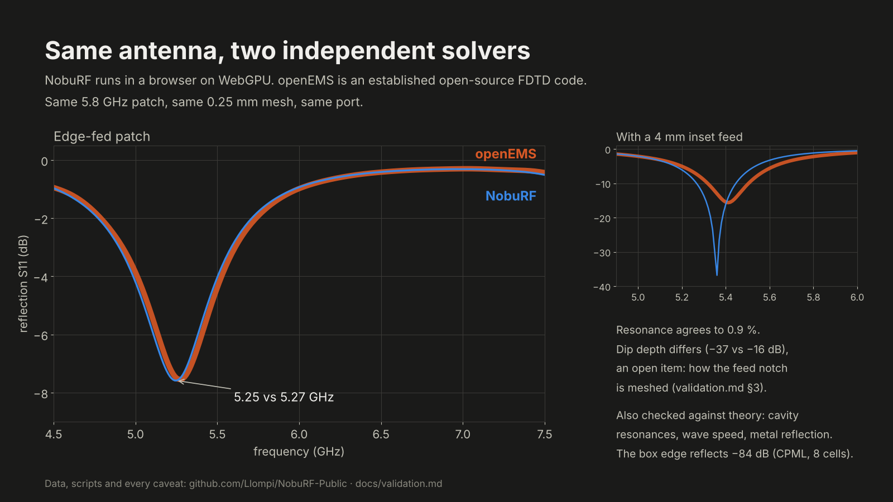

Everything here is reproducible from this repo:

```bash
npx tsx scripts/validate/analytic.ts                  # cavity, plane wave, PEC, CPML (~5 min)
npx tsx scripts/validate/patch.ts demo|inset|length|length_inset4|fields|bigbox|strip|notch
npx tsx scripts/validate/patch.ts fine baseline       # 0.25 mm, ~65 min each on one CPU core
python validation/openems/patch_openems.py [--res 0.5] # needs openEMS + CSXCAD Python bindings
python docs/validation/plot.py                        # every figure below
npx tsx scripts/validate/benchmarks.ts                # published benchmarks, section 7 (~20 min)
npx vitest run tests/validation.test.ts               # fast regression guard (< 1 s)
```

All NobuRF numbers come from the CPU reference solver (`src/engine/fdtd_cpu.ts`),
which runs the same update equations as the WGSL kernels. GPU/CPU parity on
the full demo grid is checked by `npm run test:gpu` and the in-browser
self-test (max difference ~1e-6 on a GTX 1660 Ti laptop GPU). Raw data is in
[`validation/data/`](validation/data/).

---

## 1. What is being checked

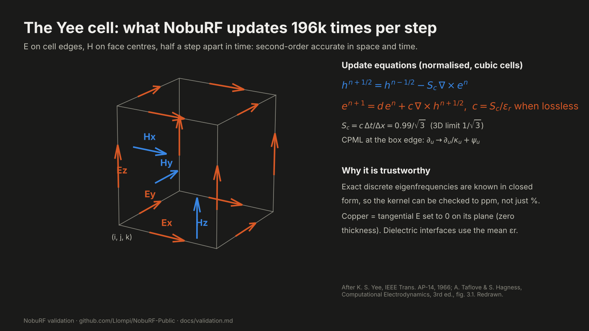

NobuRF is a standard Yee-grid FDTD solver: E on cell edges, H on face centers,
leapfrogged in time, cubic cells, Courant number 0.99/√3. Copper is
zero-thickness PEC on Yee edges; the port is a 50 Ω resistive voltage source
across the substrate. Checks fall into three tiers:

| Tier | Question | Reference |
| --- | --- | --- |
| Kernel | Is the discretisation exactly the Yee scheme, with no slips? | Closed-form discrete eigenfrequencies and dispersion |
| Physics | Does it converge to the right continuous answer? | Analytic cavity modes, plane wave, PEC short |
| Antenna | Is the patch S11 right? | openEMS on the same geometry; textbook patch models |

## 2. Kernel and physics checks (analytic answers)

### 2.1 PEC cavity: four modes, three grids, two dielectrics

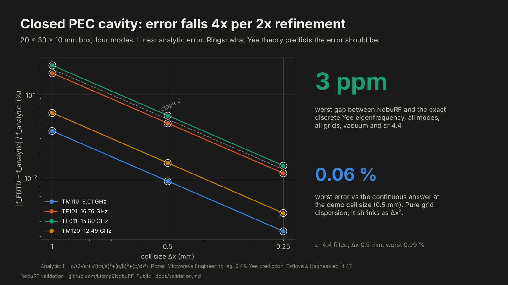

A closed 20 × 30 × 10 mm PEC box, excited off-symmetry, with four modes
(TM110, TE101, TE011, TM120) read from the ring-down spectrum.

| Δx | εr | Worst error vs analytic | Worst gap to exact Yee frequency |
| --- | --- | --- | --- |
| 1.0 mm | 1 | 0.23 % | 0.8 ppm |
| 0.5 mm | 1 | 0.056 % | 0.8 ppm |
| 0.25 mm | 1 | 0.014 % | 0.8 ppm |
| 0.5 mm | 4.4 | 0.085 % | 3.1 ppm |

- Error falls 4× per 2× refinement: the expected second-order convergence.
- The gap to the *discrete* Yee eigenfrequency (Taflove & Hagness eq. 4.47) is
  at the round-off level. So the remaining error is pure, predictable grid
  dispersion, not a bug. `tests/validation.test.ts` locks this in.

### 2.2 Plane wave and PEC short

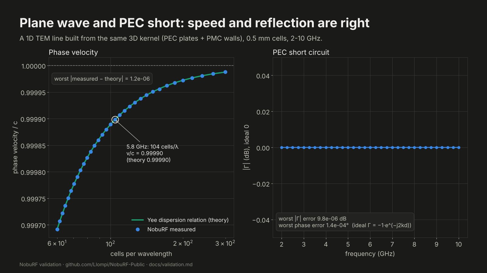

A TEM line made from the same 3D kernel (PEC plates, PMC side walls) carries a
2–10 GHz pulse.

- **Phase velocity** matches the Yee dispersion relation to **1.2e-6** over
  60–300 cells per wavelength. At 5.8 GHz on the demo grid (104 cells/λ), the
  wave travels at 0.99990 c, a 0.01 % lag.
- **PEC short:** |Γ| = 1 to **1e-5 dB**, phase = π + 2kd to **1.4e-4°**.

### 2.3 The absorbing boundary

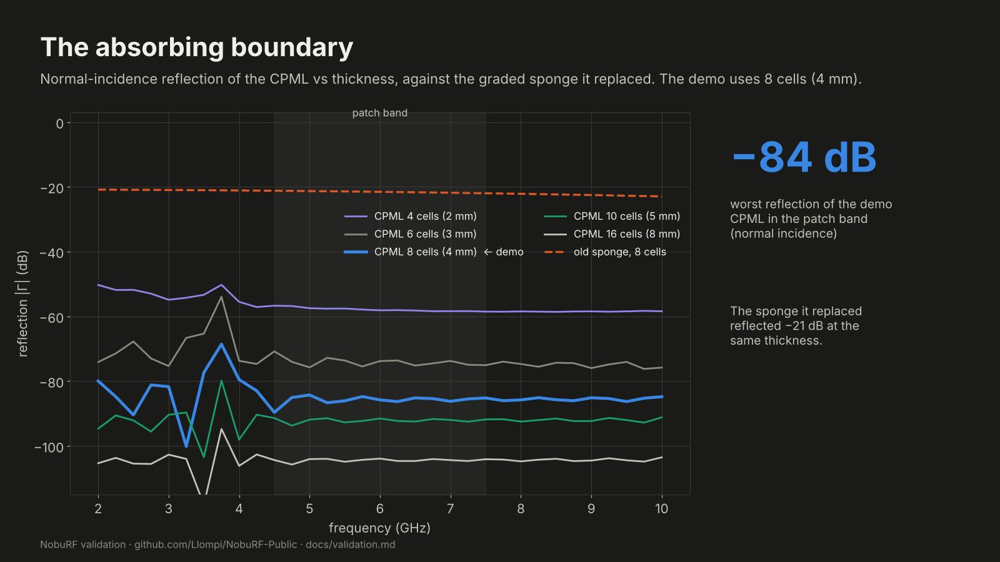

The open-space boundary is a convolutional PML (Roden and Gedney 2000; Taflove
and Hagness ch. 7): polynomial grading of order 3, σ at the optimum
0.8 (m + 1) / (η0 Δx), κ = 1, and α = 0.05 S/m at the inner face. Its auxiliary
fields live only in the boundary slabs ([`src/engine/cpml.ts`](../src/engine/cpml.ts)).
Normal-incidence reflection on the TEM line, worst case in the 4.5–7.5 GHz
patch band:

| CPML | Thickness | Worst reflection |
| --- | --- | --- |
| 4 cells | 2 mm | −56.7 dB |
| 6 cells | 3 mm | −70.8 dB |
| **8 cells (default)** | **4 mm** | **−84.3 dB** |
| 10 cells | 5 mm | −91.4 dB |
| 16 cells | 8 mm | −103.9 dB |

The graded sponge it replaced reflected −21 dB at 8 cells
([`boundary_sponge.json`](validation/data/boundary_sponge.json)). On the patch,
doubling the air and the PML thickness (the "big box" run, 0.5 mm) changes
nothing that is printed: edge-fed 5.36 GHz and −6.25 dB in both boxes, inset
5.54 GHz with −19.36 vs −19.35 dB. With the sponge, the same test moved the
inset dip by 7 dB.

Not yet checked: oblique incidence and evanescent fields close to the
boundary. The 3D dipole test in `tests/cpml.test.ts` (energy left in a box
after the pulse has left) covers both only in aggregate.

### 2.4 Frequency-dependent and magnetic materials

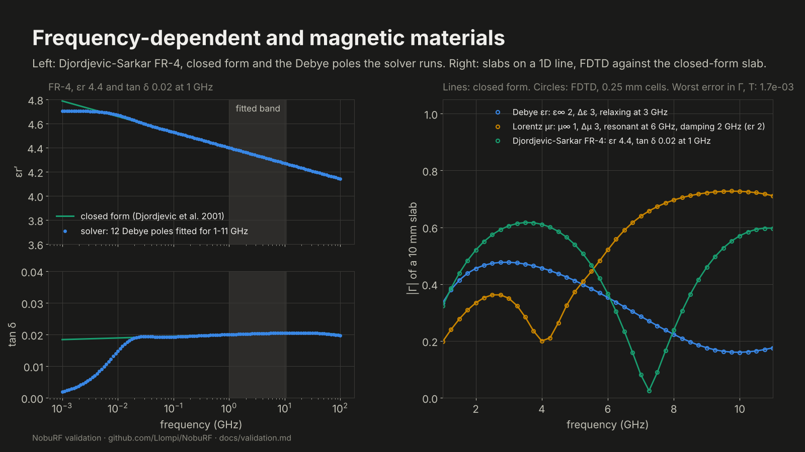

Materials can vary with frequency (Debye and Lorentz poles, the
Djordjevic-Sarkar wideband FR-4 model) and be magnetic (μr, magnetic loss,
Lorentz or Debye permeability); see project-file.md. Checks, all in
`tests/dispersion.test.ts` (data: `scripts/validate/dispersion.ts`):

- **Slab on a 1D line.** A 10 mm slab on the TEM line of section 2.2, lit at
  normal incidence. FDTD reflection and transmission against the closed-form
  slab (Fresnel plus multiple reflections, exact ε(ω) and μ(ω)), 1-11 GHz on
  0.25 mm cells: Debye εr within **4e-4**, Lorentz μr through its resonance
  within **1.2e-3**, Djordjevic-Sarkar FR-4 within **1.7e-3**. The tests add a
  Lorentz εr, a lossy constant μr and a constant εr, all within 6e-3. What is
  left is the grid's own dispersion: it grows with the refractive index.
- **The same slab, built through a project file.** A 10 mm Debye-εr,
  Lorentz-μr slab between 1 mm air layers, rasterised as a board on 0.25 mm
  cells. Its center column, laid along the line, keeps the E and H edges
  rasterise lists and their interface mix, for both in-plane polarisations
  (Ex with Hy, Ey with Hx). Measured within **1.3e-3** of the closed form,
  2-10 GHz (test bound 3e-3). Giving the face edges the whole slab instead of
  the mix reads 2e-2, so the test fails on it. Not on this path: Hz on a
  magnetic interface (rasterise warns about it instead).
- **Magnetic and electric sides agree.** A slab with ε(ω) = μ(ω) (Lorentz,
  lossy) is matched to free space at every frequency: |Γ| < 2e-3.
- **Djordjevic-Sarkar model.** Its real part is the Kramers-Kronig transform
  of its loss to 1e-4 (a check of the implemented formula, which is causal by
  construction). The solver's Debye-pole fit matches the closed form to 1e-4
  in εr′ and 0.3 % in εr″ inside the analysis band; outside it the fit is
  allowed to drift (figure, left).
- **The ADE reduces to the old update.** Every substrate edge of the FR-4 test
  patch listed as a constant medium gives the same port voltage as the plain
  update, to 1e-4 of its peak.
- **GPU.** The WebGPU kernel matches the CPU reference on a patch on
  Djordjevic-Sarkar FR-4 under a lossy ferrite cover (both fields dispersive,
  interfaces included): `npm run test:gpu:node`, check 11.

- **Measured tables.** A table of 8 to 12 rows read off the Djordjevic-Sarkar closed
  form (1-10 GHz, 0.1-40 GHz, 1 MHz-1 GHz) comes back within 1e-5 in εr′ and
  1e-4 in εr″, between the rows too. A 10 mm slab built from an 8-row table
  matches the Djordjevic-Sarkar slab within 6e-3, 2-10 GHz. One sharp Debye
  relaxation off the fit's frequencies is the worst case, within 7 % of its
  peak loss, and is reported. `tests/permittivity_table.test.ts`.

### 2.5 Copper loss across frequency: skin effect and roughness

Copper faces carry the skin-effect impedance (1 + j) Rs(f), Rs ∝ √f, times a
roughness factor (project-file.md, "Conductor loss"). Checks, in
`tests/surface_impedance.test.ts`:

- **The fit.** On four bands (1-10, 4-8, 0.05-20, 0.1-40 GHz), smooth copper
  is fitted within 1e-4 in R and 0.3 % in X, and Hammerstad, Groisse and Huray
  rough copper within 1e-3 in R (a very rough Huray foil, surface ratio near
  the schema's 50, fits to about 6e-3 over 0.01-1000 GHz); every branch weight is non-negative (causal
  and passive). The roughness factors match their published formulas.
- **The update.** A pulse on a 1D float32 line reflects off a wall whose face
  loss is the fitted shape (Rs 2 Ω at 5 GHz, lossier than copper so the
  absorbed share is measurable). The share it absorbs, against a PEC wall,
  follows the exact wall 1 − |(Zs − η0)/(Zs + η0)|² with Zs = (1 + j) Rs(f)
  from 1 to 20 GHz within **0.1 %** on 0.1 mm cells and **0.5 %** on 0.5 mm
  cells (test bounds 0.2 % and 1 %). A single-frequency Rs is off by √(f / 5 GHz) there, 2.2 times at
  1 GHz. The high-pass branches use H extrapolated to E's time; without that
  the reactance leaked into loss, 2.4 % at 20 GHz on 0.1 mm cells.

Not checked yet against a measured rough-copper line loss.

Not yet checked against a measured magnetic part (a ferrite-loaded coil or
inductor); see section 7.6.

## 3. The patch antenna vs openEMS

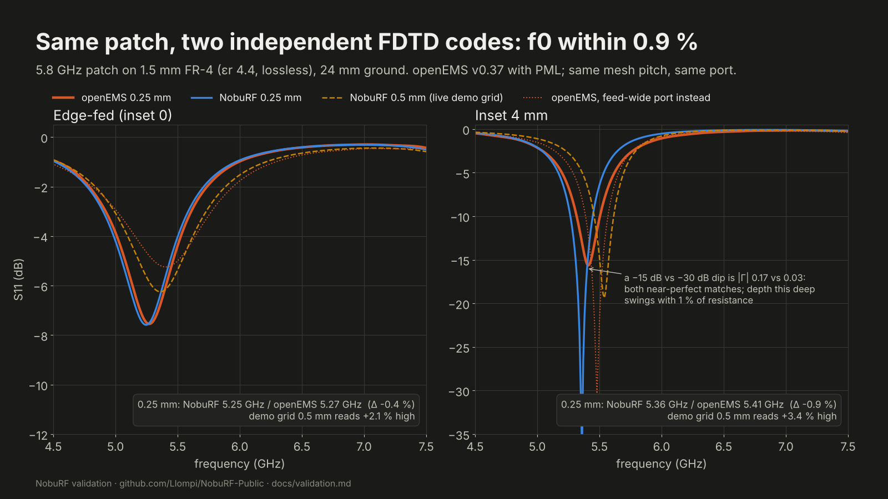

**Setup, identical in both codes:** 16 × 12.4 mm patch on 1.5 mm FR-4
(εr 4.4, lossless), 24 × 24 mm finite ground and substrate, 2.5 mm × 4 mm
microstrip feed, zero-thickness PEC, 50 Ω lumped port at the feed end.
openEMS v0.37.0 (prebuilt Windows build, 8 threads) with a PML on all six
faces, 20 mm of air, a graded mesh with 0.25 mm on the board, and a −50 dB
energy end criterion. Script: [`validation/openems/patch_openems.py`](../validation/openems/patch_openems.py).

| Case | NobuRF 0.25 mm | openEMS 0.25 mm (same port) | Δf0 | NobuRF 0.5 mm (demo) |
| --- | --- | --- | --- | --- |
| Edge-fed | 5.25 GHz, −7.6 dB | 5.27 GHz, −7.6 dB | **−0.4 %** | 5.36 GHz, −6.3 dB |
| Inset 4 mm | 5.36 GHz, −36.8 dB | 5.41 GHz, −15.6 dB | **−0.9 %** | 5.54 GHz, −19.4 dB |

NobuRF runs here use the CPML and run 24,000 steps at 0.25 mm and 12,000 at
0.5 mm, long enough for the ring-down to finish.

What this shows, and what it doesn't:

- **Resonance agrees** at matched resolution, within 1 %. The edge-fed
  curves sit on top of each other across the band.
- **The live demo grid reads high**: vs openEMS at 0.25 mm by 1.7 % (edge-fed)
  and 2.4 % (inset); vs NobuRF's own 0.25 mm run by 2.1 % and 3.4 %. That's the
  price of a 0.5 mm grid with a 3-cell substrate. (openEMS's own 0.5 mm mesh is
  off by about 1 % the other way, 5.21 GHz edge-fed: coarse-mesh errors depend
  on how each code meshes edges.)
- **Dip depth for the inset case differs** (−37 vs −16 dB). Below about
  −20 dB, depth is not a usable metric: |Γ| 0.01 vs 0.17 is the difference
  between 50 Ω and 37 Ω. Compare impedance at each dip instead:

  | Inset 4 mm, at the dip | f0 | Z_in | S11 |
  | --- | --- | --- | --- |
  | NobuRF 0.25 mm (one-edge port) | 5.36 GHz | 49.8 + 1.4j Ω | −36.8 dB |
  | openEMS, one-edge port | 5.41 GHz | 37.2 + 6.7j Ω | −15.6 dB |
  | openEMS, feed-wide port | 5.48 GHz | 47.6 + 1.6j Ω | −30.5 dB |

  openEMS's two port models differ by 10 Ω and 15 dB on the same board. That
  NobuRF's inset impedance lands on the feed-wide port's is a coincidence,
  not a port mismatch. NobuRF's port is openEMS's one-edge ("line") port: one
  Ez column at the feed center, R split in series, V summed up the column, I
  from the H loop around its middle cell, which is what openEMS's
  `AddLumpedPort` builds and probes for a start/stop on one line. On the
  edge-fed patch at 0.25 mm the two codes' line-port Z(f) differ by 12 Ω mean
  over 4.8 to 6.2 GHz (34 Ω to openEMS's feed-wide port). On the inset patch
  they differ by about 80 Ω mean whichever openEMS port is taken, several times
  what the port choice moves. So the inset gap is in the inset response, not the
  port.

  NobuRF has the feed-wide port too, as an option (`voxelize(..., 'strip')`:
  one column on every node across the trace, R shared in parallel, V on the
  center column, I through all columns; `npx tsx scripts/validate/patch.ts
  strip`). On the 0.5 mm demo grid, line to strip:

  | Case | NobuRF line → strip | openEMS 0.5 mm line → strip | openEMS 0.25 mm line → strip |
  | --- | --- | --- | --- |
  | Edge-fed f0 | 5.36 → 5.48 GHz (+2.2 %) | 5.21 → 5.32 (+2.1 %) | 5.27 → 5.41 (+2.7 %) |
  | Inset, X at 5.4–5.5 GHz | −16 Ω | −19 Ω | −24 Ω |
  | Inset dip | −19.4 → −12.1 dB | −13.2 → −18.0 dB | −15.6 → −30.5 dB |

  The strip port does the same thing in both codes: it removes the series
  inductance of the one-edge filament. The dips move opposite ways because the
  inset Z(f) under the port is already capacitive in NobuRF (48 − 10j Ω) and
  inductive in openEMS (33 + 7j Ω). How sensitive that is to the notch: a
  one-cell change of the 1 mm notch gap on the demo grid moves the inset dip
  from −13.4 dB (1.5 mm) to −26.1 dB (0.5 mm), as much as the port does
  (`patch.ts notch`). openEMS's graded mesh puts lines on the notch edges;
  NobuRF snaps them to 0.5 mm.
- **The port model matters more than the mesh.** In openEMS alone, swapping
  the one-edge port for a feed-wide port moves the edge-fed f0 from 5.27 to
  5.41 GHz (+2.7 %). Any S11 comparison has to state its port.

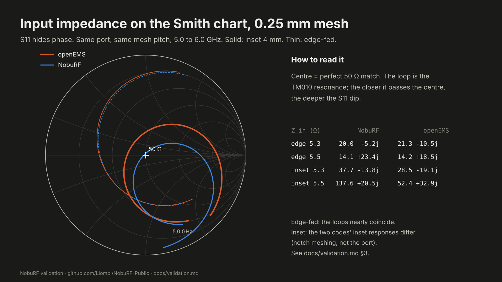

### 3.1 Graded mesh: the same patch, meshed like openEMS

The uniform runs above put every edge on a 0.25 or 0.5 mm grid, so the 12.4 mm
patch and the inset notch snap. The graded runs use the project files in
[`validation/projects/`](../validation/projects/): the openEMS geometry
exactly (feed from y = −10.2 mm, port at −10.0 mm, 1 mm notch gaps, 20 mm of
air, 8-cell PML), mesh lines on every copper edge, the port and the
interfaces, cells growing by at most 1.3 to 1.875 mm (λ/20 at 8 GHz). CPU
reference solver, −50 dB energy stop. Results and S11 files are in
[`validation/data/graded/`](validation/data/graded/).

```bash
npm run noburf -- solve validation/projects/patch_inset4_graded_e0.25_d6.json --cpu
```

Copper edge lines placed inside the copper (the default since PR #58, see
below); the files in `validation/data/graded/` are these runs:

| Case | Mesh at copper, substrate cells | Cells | f0 | S11 at dip | Z at dip | openEMS 0.25 mm, 1/3–2/3 edge rule (one-edge port) | Δf0 | Mean \|ΔZ\| 4.8–6.2 GHz |
| --- | --- | --- | --- | --- | --- | --- | --- | --- |
| Edge-fed | 0.25 mm, 6 | 776k | 5.32 GHz | −8.0 dB | 23.9 − 14.7j Ω | 5.34 GHz, −8.2 dB, 24.1 − 14.0j Ω | −0.4 % | 8.1 Ω |
| Inset 4 mm | 0.25 mm, 6 | 935k | 5.48 GHz | −22.1 dB | 44.8 + 5.4j Ω | 5.47 GHz, −20.4 dB, 42.2 + 4.0j Ω | +0.2 % | 9.8 Ω |
| Edge-fed | 0.5 mm, 3 | 350k | 5.32 GHz | −7.5 dB | 22.4 − 14.8j Ω | 5.34 GHz | −0.4 % | 13.8 Ω |
| Inset 4 mm | 0.5 mm, 3 | 388k | 5.48 GHz | −25.3 dB | 47.1 + 4.5j Ω | 5.47 GHz | +0.2 % | 23.3 Ω |

These rows were rerun on main b413166 (Nov 27, 2026). The first version of
this table (solver c18269a, Nov 20) read 5.30 / 5.47 GHz at 0.25 mm and
5.32 / 5.40 GHz at 0.5 mm, with mean |ΔZ| 14.2, 10.7, 17.4 and 59.1 Ω. What
moved them is PR #83 (with its follow-up #98): the mesh now keeps uniform
edge cells around every corrected copper edge, so the inset notch edges that the 0.5 mm mesh used to
leave on their drawn lines are corrected too. That costs cells (1.35 to 1.8
times as many here) and is the reason the 0.5 mm inset row now lands on the
0.25 mm one. One edge per case still keeps its drawn line: the feed end at
y = −10.2 mm, 0.2 mm from the port line, too close to correct (the solver
warns about it).

The openEMS column uses openEMS's own advice for zero-thickness metal: mesh
lines a third of a cell inside each copper edge and two thirds outside
(`patch_openems.py --edges thirds`). Its earlier runs put the lines on the
drawn edges (5.27 and 5.41 GHz, inset 37.2 + 6.7j Ω at the dip); against
those, these NobuRF rows read +0.9 % and +1.3 % with mean |ΔZ| 15.4 and
23.5 Ω. openEMS moved by +1.1 to +1.3 % when its edges moved, and NobuRF by
+1.7 % between the lower table and this one, so the earlier near-agreement
on the inset (−0.4 %, 1 Ω, lower table) was the same edge error in both.

The same runs with lines on the drawn edges, as openEMS's script places them
(before PR #58; the bullets below describe these):

| Case | Mesh at copper, substrate cells | Cells | f0 | S11 at dip | Z at dip | Δf0 | Mean \|ΔZ\| 4.8–6.2 GHz |
| --- | --- | --- | --- | --- | --- | --- | --- |
| Edge-fed | 0.25 mm, 6 | 443k | 5.23 GHz | −7.5 dB | 22.6 − 15.5j Ω | −0.8 % | 10.6 Ω |
| Inset 4 mm | 0.25 mm, 6 | 519k | 5.39 GHz | −16.3 dB | 38.2 + 6.5j Ω | −0.4 % | 11.2 Ω |
| Edge-fed | 0.5 mm, 3 | 266k | 5.15 GHz | −6.7 dB | 21.3 − 18.5j Ω | −2.3 % | 24.2 Ω |
| Inset 4 mm | 0.5 mm, 3 | 287k | 5.32 GHz | −13.5 dB | 34.0 + 7.7j Ω | −1.7 % | 41.7 Ω |

- **The inset gap closes.** On the uniform 0.25 mm mesh the inset dip was
  −36.8 dB against openEMS's −15.6 dB, and the two Z(f) curves differed by
  about 80 Ω mean. With lines on the notch edges, NobuRF lands at −16.3 dB
  and 38 Ω, and the mean difference drops to 11 Ω, the same as the edge-fed
  patch. The gap was the notch snapping, not the port or the kernel.
- **Edge-fed agreement stays where it was**: −0.8 % in f0, 10.6 Ω mean.
- **A coarse graded mesh reads low, not high.** At 0.5 mm on the copper with
  three substrate cells, both cases land 1.7 to 2.3 % below openEMS at
  0.25 mm. The uniform 0.5 mm grid read 1.7 to 2.4 % high. The substrate cell
  count is the larger lever: six cells across 1.5 mm is what the 0.25 mm
  rows use.
- These runs took 5 to 8 minutes each on one CPU core (four at once). The
  smallest cell is the 0.2 mm between the feed end and the port, which sets
  the time step.

**Copper edges placed inside the copper.** A zero-thickness copper edge on
the Yee grid acts about a third of a cell past its last copper node (0.3535
of a cell for square cells, from a discrete half-plane solve in
[`src/engine/yee_edge.ts`](../src/engine/yee_edge.ts)), so with lines on the
edges every patch and strip acts about 0.7 cell wider than drawn. openEMS's
script puts its lines on the edges too, so both codes share this, which is
why they agreed with each other and both drifted with the mesh. Since PR #58
NobuRF places each copper edge's line that offset inside the copper on
graded meshes ([project-file.md](project-file.md#graded-mesh)):

| Case | NobuRF, lines on edges (0.5 → 0.25 mm) | NobuRF, edges placed inside (0.5 → 0.25 mm) | openEMS, lines on edges (0.5 → 0.25 mm) | openEMS extrapolated (first order) |
| --- | --- | --- | --- | --- |
| Edge-fed f0 | 5.15 → 5.23 GHz (+1.6 %) | 5.32 → 5.32 GHz (0.0 %) | 5.21 → 5.27 GHz (+1.2 %) | 5.33 GHz |
| Inset 4 mm f0 | 5.32 → 5.39 GHz (+1.3 %) | 5.48 → 5.48 GHz (0.0 %) | 5.35 → 5.41 GHz (+1.1 %) | 5.47 GHz |

- With the edges placed inside, NobuRF does not move between 0.5 and
  0.25 mm on either patch, while both codes with lines on the edges climb
  about 1.2 % per halving, the first-order drift a 0.7-cell widening
  predicts.
- Before PR #83 the inset patch at 0.5 mm was not a clean test: the grading
  left the cell beside one notch edge pair outside 0.8 to 1.2 edge cells, so
  those edges kept their drawn lines, the row read 5.40 GHz and drifted like
  the uncorrected mesh, and its Z near the dip was 59 Ω (mean) from
  openEMS's. With the edge cells held uniform around each corrected edge it
  reads 5.48 GHz, the same as at 0.25 mm, and 23 Ω mean. That is still the
  largest Z difference here: three substrate cells is coarse for the notch.
- Against openEMS at 0.25 mm with lines on the edges the difference is
  +0.9 % (edge-fed) and +1.3 % (inset), with NobuRF above; against its two
  meshes extrapolated at first order, −0.2 % and +0.2 %.
- openEMS meshed by its own 1/3–2/3 rule settles it without extrapolating:
  5.34 and 5.47 GHz at 0.25 mm, within 0.2 % of the extrapolation (the
  inset moves to 5.46 GHz, −17.8 dB at 0.125 mm, so it has converged), and
  NobuRF is −0.4 % and +0.2 % from it (first table). At the inset dip the
  impedances differ by 2.6 Ω in R and 1.4 Ω in X (mean |ΔZ| 9.8 Ω over the
  band, from 11.2 Ω with both on the edges). The edge-fed mean |ΔZ| is
  8.1 Ω, from 10.6 Ω.

### 3.2 A modelled SMA connector instead of a lumped port

Every run above feeds the patch with a lumped port: a 50 Ω source in one
vertical column of the grid. A real board is fed through a connector. Here the
inset patch gets an edge-launch SMA instead, built in the grid as metal and
PTFE: a 1.27 mm pin in a 4.10 mm PTFE bore (ε_r 2.08), a square body at the
board edge bonded to the ground plane, and the pin reaching 1.5 mm over the
trace. The coax runs out through the air and into the PML, which is its
matched far end. Code: [`src/engine/coax_feed.ts`](../src/engine/coax_feed.ts);
driver: [`scripts/coax_feed.ts`](../scripts/coax_feed.ts).

How S11 is measured, as in an openEMS coax port or a commercial solver's wave port:

- The source adds the line's TEM field on one cross-section inside the coax.
  The field comes from a 2D Laplace solve on the same staircased edges, so it
  is the exact mode of the discrete line and launches no higher-order modes.
- Two probe planes read the mode voltage. A second, short run on an endless
  piece of the same coax gives the incident wave at each probe; the reflected
  wave is the difference.
- The phase constant measured between the probes moves the reference plane to
  the flange. The result is Z_in at the board edge and S11 re 50 Ω: what a VNA
  calibrated at the connector would read, with the connector-to-trace
  transition included.

Checks in [`tests/coax_feed.test.ts`](../tests/coax_feed.test.ts): a coax
that runs into the PML reads below −35 dB; a short at the flange reads Γ = −1
within 3°; a step from the SMA line to a thinner pin reads the impedance ratio
of the two lines (0.0462 against 0.0461).

To compare like with like, the feed trace runs to the board edge (y = −12 mm)
and the lumped port moves there too. Both NobuRF runs use the same mesh, with
0.125 mm cells across the coax. openEMS runs the same board with its own
`CoaxialPort` ([`validation/openems/coax_feed_openems.py`](../validation/openems/coax_feed_openems.py)).

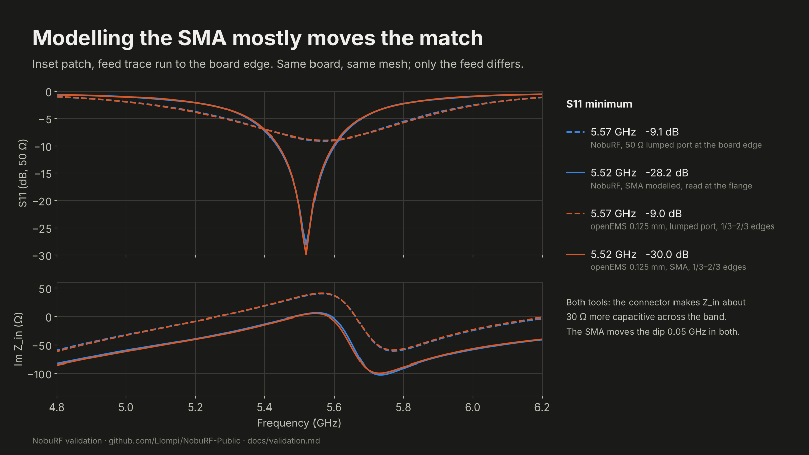

| Feed | NobuRF 0.25 mm, 6 cells | NobuRF 0.5 mm, 3 cells | openEMS 0.25 mm | openEMS 0.125 mm |
| --- | --- | --- | --- | --- |
| Lumped port at the board edge | 5.57 GHz, −9.1 dB | 5.56 GHz, −9.2 dB | 5.53 GHz, −10.6 dB | 5.57 GHz, −9.0 dB |
| SMA, read at the flange | 5.52 GHz, −28.2 dB | 5.51 GHz, −29.5 dB | 5.52 GHz, −28.6 dB | 5.52 GHz, −30.0 dB |
| Im Z_in, SMA minus lumped, 5.0 to 5.5 GHz (mean) | −27 to −32 Ω (−30.7) | −28 to −32 Ω (−30.7) | −21 to −26 Ω (−24.7) | −29 to −33 Ω (−32.0) |

Both codes were run on Nov 27, 2026: NobuRF on the current solver, openEMS v0.37
meshed by its own 1/3–2/3 rule for thin copper (`coax_feed_openems.py
--edges thirds`). The quantities and pass limits were committed before
either run ([`validation/openems/coax_thirds/`](../validation/openems/coax_thirds/README.md)):
f0 within 1 % for each feed and the mean reactance shift within 5 Ω, NobuRF
at 0.25 mm against openEMS at 0.125 mm. All three pass: 0.0 % (the same
0.01 GHz grid point) for both feeds and 1.3 Ω for the shift. openEMS moves
by 0.7 % (lumped) and 0.0 % (SMA) between its two meshes.

The first version of this table (Nov 19) had NobuRF before PRs #58 and #83
(5.45 / 5.36 GHz lumped, 5.45 / 5.38 GHz SMA) and openEMS with lines on the
drawn copper edges (5.46 / 5.52 GHz lumped, 5.46 / 5.49 GHz SMA). Both moved
up by about 1 %, as the patch did in section 3.1. Figure 11 shows the Nov 27
runs; Figure 12 is the Nov 19 field.

What this shows:

- **The resonance moves a little.** The connector moves the dip down by
  0.05 GHz (0.9 %) in both codes at their finest meshes.
- **The match moves more.** With the connector modelled, Z_in at the board
  edge is about 30 Ω more capacitive across the band, and the real part
  barely changes. NobuRF reads −30.7 Ω on average on both meshes; openEMS
  reads −24.7 Ω at 0.25 mm and −32.0 Ω at 0.125 mm, so this is its least
  converged quantity. For this patch that turns a −9 dB dip into a −28 to
  −30 dB one in both codes, because the lumped-port result was inductive at
  resonance.
- **Why, in part.** A lumped port drives current up a single column with no
  return path of its own, which adds an inductance that a real connector
  does not have; the connector instead brings its own shunt capacitance from
  the pin over the trace and the bore mouth. We have not separated the two
  yet. A thru-line case (connector into a matched microstrip, no patch) would.
- **Depth is not a stable number.** Near a perfect match the dip depth swings
  with a few ohms of Z (openEMS's lumped dip moves 1.6 dB between its two
  meshes). Compare Z, not dip depth.

Limits of this model, stated plainly:

- The staircased line reads 45.9 Ω at 0.125 mm cells (47.4 Ω at 0.0625 mm)
  against 48.8 Ω for a round SMA line, because every edge touching metal is
  metal. That line impedance is de-embedded, but the pin at the transition is
  about 0.06 mm fatter than drawn.
- The connector is a generic edge-launch geometry, not a specific
  manufacturer's part. Real launches have tab pins, ground legs and solder.
- In the workbench the coax feed runs on the CPU reference solver only; the
  `noburf` CLI also runs it on the GPU kernels.

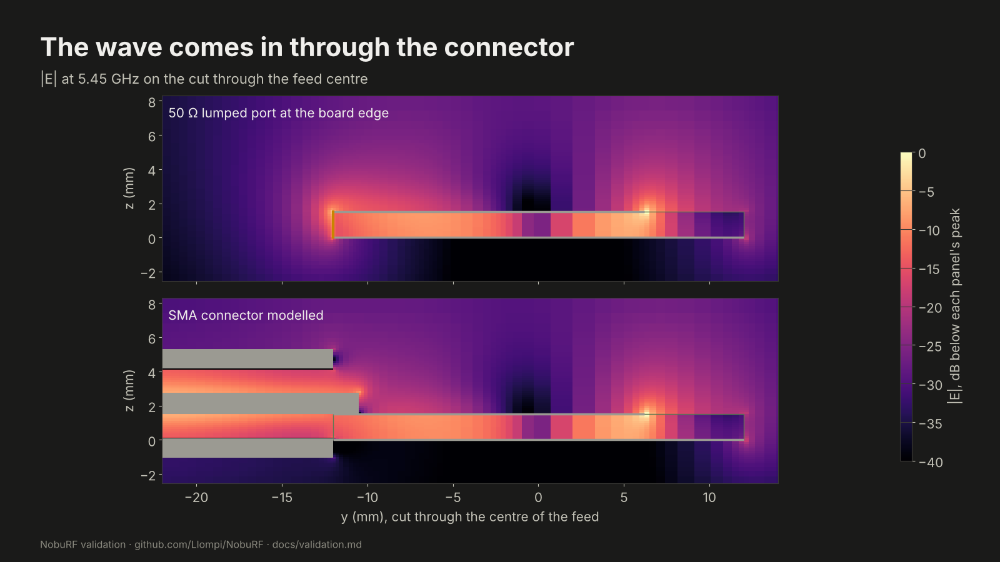

### 3.3 A curved 3D antenna: the open helix

The [Gonzaga open helix](benchmarks/gonzaga.md) has two dipoles wrapped on a
cylinder. It is the first curved 3D structure compared with openEMS. The
quantities and limits were committed before either code ran
([`validation/openems/helix/`](../validation/openems/helix/README.md)). Both
codes use PEC copper and a lossless disk. openEMS can't draw a curved sheet on
its Cartesian grid: cylindrical polygons give no metal, and a 0.1 mm shell
covers 3 % of the arms. So its arms are a grid of curves snapped onto the
mesh, a staircase that covers 100 % of the arm area. NobuRF ran both its
staircase arms and its conformal sheet arms.

| Quantity | openEMS 1 mm | openEMS 0.5 mm (reference) | NobuRF staircase 1 mm | NobuRF sheet 1 mm | Limit |
| --- | --- | --- | --- | --- | --- |
| S11-minimum frequency | 921 MHz | 941 MHz | 920 MHz (−2.2 %, fail) | 938 MHz (−0.3 %, pass) | 1 % |
| −10 dB bandwidth | 43 MHz | 49 MHz | 52 MHz (pass) | 53 MHz (pass) | 10 % |
| S11 minimum | −12.6 dB | −13.4 dB | −19.2 dB (fail) | −19.6 dB (fail) | 3 dB |
| Z_in at 915 MHz | 68.6 + j22.6 Ω | 42.2 + j31.2 Ω | 57.1 + j11.7 Ω (fail) | 38.6 + j22.6 Ω (fail) | 10 % of \|Z\| |
| Azimuth RHCP gain | 1.59 dBi | 1.56 dBi | 1.59 dBi (pass) | 1.57 dBi (pass) | 0.5 dB |
| Mean axial ratio | 2.98 dB | 3.30 dB | 3.04 dB (pass) | 3.32 dB (pass) | 1 dB |

- **The reference is not converged.** openEMS's resonance moves +2.2 % from
  1 to 0.5 mm, more than the 1 % its runs were meant to settle within, and
  its Z at 915 MHz moves by 27 Ω. A finer openEMS mesh (about 11 M cells) was
  not added after seeing this, because it was not part of the plan written
  before the runs.
- **Both staircases climb toward NobuRF's sheet arms as the cells shrink.**
  At 1 mm the two staircases agree (920 against 921 MHz). NobuRF's sheet arms
  move only 938 → 943 MHz from 1 to 0.7 mm.
- **The far field agrees everywhere.** Gain within 0.03 dB, axial ratio within
  0.3 dB. openEMS confirms that 10.5° pitch gives about 3 dB axial ratio at
  this radius, so that number in gonzaga.md is not a NobuRF error.
- **The match does not agree yet.** openEMS's dip is 6 dB shallower and its Z
  at 915 MHz differs by 18 % for the sheet arms, which is less than openEMS
  moves between its own two meshes. Read the S11 depth of this antenna as
  unsettled. Full results: [`results.md`](../validation/openems/helix/results.md).

### Step budget (live demo vs converged)

The live demo runs 3000 steps (2.9 ns). Against a converged 12000-step run on
the same grid, f0 is unchanged (5.53 vs 5.54 GHz for the inset patch). The dip
depth isn't: −16.5 vs −19.4 dB. The `noburf` CLI avoids the question: it stops
when the field energy has fallen a set amount (50 dB in the example project).

## 4. The patch vs textbook models

### 4.1 Resonance vs length (transmission-line model)

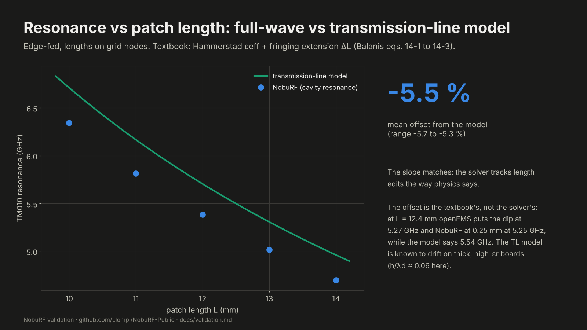

Edge-fed patches, L = 10 to 14 mm, with edges on grid nodes, on the 0.5 mm
demo grid. NobuRF tracks the slope of Balanis' transmission-line model
(eqs. 14-1 to 14-3), sitting **−5.1 to −6.9 %** below it (−6.9 % at 10 mm,
−5.1 % at 14 mm). Most of that offset belongs to the textbook model, not the
solver: at L = 12.4 mm openEMS puts the resonance at 5.27 GHz and NobuRF at
0.25 mm at 5.25 GHz, while the model says 5.54 GHz. The TL model is known to
drift on electrically thick, high-εr boards (h/λd ≈ 0.06 here).

### 4.2 Inset feed (cavity model)

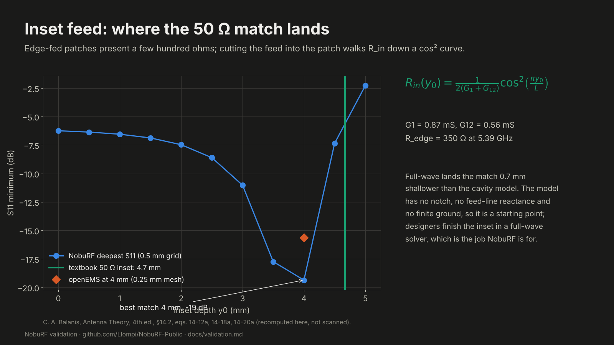

Balanis' cavity model (eqs. 14-12a, 14-18a, 14-20a, recomputed here) gives
R_edge = 347 Ω and puts the 50 Ω inset at 4.7 mm. NobuRF's best match is at
4.0 mm (−19.4 dB on the 0.5 mm grid, 12,000 steps; 3.5 mm gives −17.7 dB). The model has no notch, no feed reactance and no finite
ground, so it's a starting point. Finishing the inset with a full-wave sweep is
exactly the job NobuRF is for.

### 4.3 The field looks like TM010

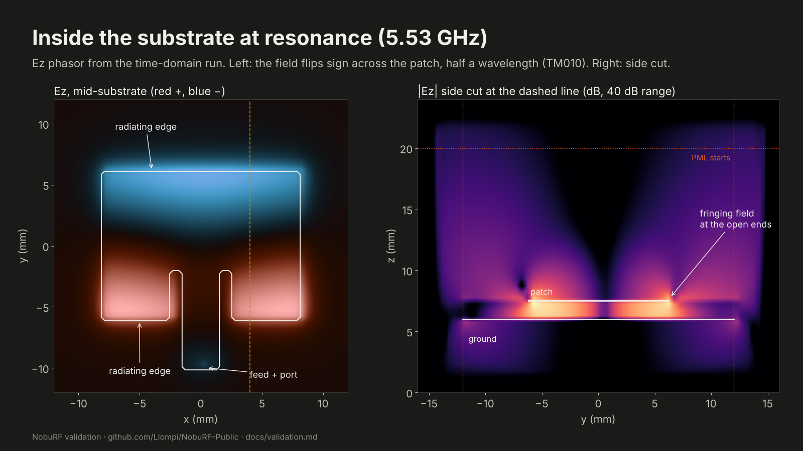

The Ez phasor at resonance has a half-wavelength variation along L, with
opposite signs under the two radiating edges and a null down the middle. The
side cut shows the fringing fields at the open ends, which are what radiate.
This is the textbook TM010 cavity picture (Balanis §14.2), computed rather
than drawn.

### 4.4 Far field: near-to-far-field transform

The CLI's far field (`outputs.far_field_ghz`, see
[project-file.md](project-file.md#far-field)) transforms the tangential E and H
on a closed box in the air to the far field. Checks in
`tests/near_to_far.test.ts`:

| Case | Directivity | Efficiency (radiated / accepted) | Sphere integral / box flux |
| --- | --- | --- | --- |
| Short z dipole (2 mm port, 1 mm cells, 2 and 4 GHz) | 1.761 and 1.762 dBi (Hertzian 1.761), pattern within 0.1 dB of sin²θ from 10° to 170° | 1.000 | 1.000 |
| Example patch, 1 mm cells, 5.2 GHz | 6.30 dBi at broadside (aperture estimate 6.84) | 1.007 | 0.998 |
| Example patch, 0.5 mm cells (`xy` margin 4), 5.35 GHz | 6.35 dBi at broadside (aperture estimate 6.60) | 0.999 | 0.997 |
| Short dipole on a graded mesh (0.5 mm core growing to 4 mm, 3 GHz) | 1.75 dBi; the box on unequal cells and a box in the uniform core agree to 0.01 % in power | n/a (see below) | 0.998 |
| Graded example patch (`examples/patch-5g8-graded.json`, margins 4), 5.25 GHz | 6.29 dBi at broadside; E-plane beamwidth 93°, H-plane 97°, front to back 12.5 dB | 1.000 | 0.998 |

The patch is lossless, so radiated power should equal the power the port
accepts; it does within 1 %, which checks the port, the box DFT and the
flux together. The aperture estimate the viewer shows assumes an infinite
ground and integrates the upper hemisphere only, so it reads a little high.
The GPU box DFT matches the CPU one to 1e-6 (`npm run test:gpu:node`), on
uniform and graded meshes.

On a graded mesh the box faces fall between cells of unequal width, and H,
which lives at cell centers, is interpolated linearly to the face. Without
that the graded dipole's box read 1 % low in power and 0.07 dB low in
directivity.

Efficiency is radiated over accepted power, and accepted power is
½ Re(V I*) at the port. For a port that is nearly a pure reactance, such as
a very short dipole (R_rad 0.3 Ω against kilohms of reactance), that real
part is a small difference of large numbers and the port reading is not
reliable: the 4-cell dipole at 0.5 mm reads efficiency 0.13 while its box
power agrees with R_rad |I|² to 6 %. A patch near resonance (Z near 50 Ω)
is well conditioned. On the dipole only ports of one or two series cells
read correctly (3, 4 and 6 cells read 0.11 to 0.20), so the port code is
the suspect, not the box; the graded-mesh test uses two cells. Pattern cuts and the 3D lobe for any far-field run
are in the results bundle (`pattern_<f>ghz.svg`, `.glb`).

To compare with openEMS, `validation/openems/patch_openems.py --nf2ff`
writes openEMS's own full-sphere pattern, directivity and radiation
efficiency for the same patch (to be run on a machine with openEMS).

### 4.5 Near field and field at a distance

The Emissions view (`outputs.near_field_mm`) reads the solver's fields on a
plane over the board, and the field at 3 m and 10 m from the far-field box
with the full Green's function (`src/engine/near_field.ts`). The checks, in
`tests/near_field.test.ts`, on a 2 mm dipole (1 mm cells) at 3 GHz and on
the example patch (1 mm cells) at 5.2 GHz:

| Check | Result |
| --- | --- |
| Transform vs closed form (2 mm line of uniform current, moment from the far field), 20 to 60 mm, six directions | E and H within 0.32 % at 20 mm, 0.04 % at 30 mm, 0.02 % at 60 mm |
| Scan plane 10 mm above the dipole (kR 0.63) vs closed form | E within 3.4 %, H within 2.1 % |
| Transform from a 10 mm box vs scan plane 5 cells above it | E within 2.9 %, H within 2.4 %, the same gap as the closed form's |
| Hz from the curl of E vs the solver's own Hz | 1e-4 (float32 rounding) |
| Patch: transform from a box 5 cells over the copper vs scan plane 7 cells above that box | RMS error 0.10 % (E) and 0.09 % (H) of the peak |
| Patch: far field from that low box vs the default box | same directivity within 0.05 dB, power within 1 % |
| Transform at 3 m vs far field / r | 0.1 % |

The scan plane's error next to a small source is its own: Ez and Hx, Hy sit
half a cell either side of the plane and are interpolated linearly across a
field that falls as 1/r^3 (+1.5 % at 10 cells), and the Yee grid's near field
10 cells from a 2-cell source is itself a few percent off. Over a board, with
fields that vary over several cells, the scan and the transform agree to
0.1 %. At 3 m the transform matches the far field to 0.1 % (the exact
example patch, graded mesh: 0.2667 V/m against 0.2670 V/m from directivity
and power, 1 V source).

The figures at a distance assume free space and the direction of peak gain.
A test site with a ground plane adds the reflection (up to 6 dB), and the
FCC Part 15.109 limits shown beside them are for unintentional emissions.

## 5. Known limits found by this harness

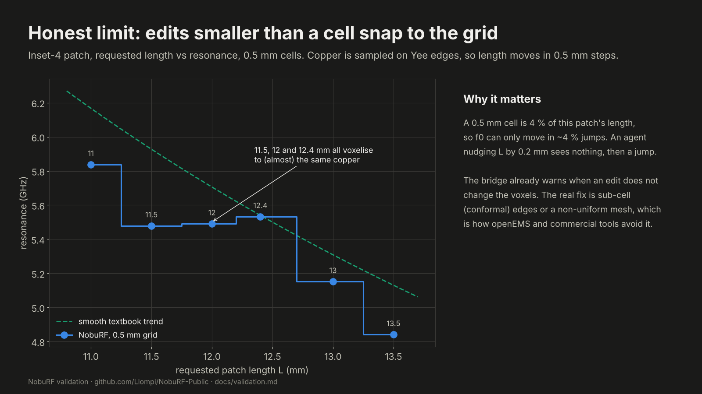

1. **On a uniform mesh, edits smaller than a cell snap to the grid.** Copper is sampled on Yee
   edges, so at 0.5 mm the patch length moves in 0.5 mm steps (~4 % in f0).
   A graded mesh (`mesh.graded`) puts lines on the edges instead (section 3.1).
   With a 4 mm inset, 11.5, 12 and 12.4 mm voxelise to nearly the same copper
   and resonate within about 1 % of each other (5.48, 5.50 and 5.54 GHz). The bridge already warns when an edit
   leaves the voxels unchanged.
2. **Coarse substrate.** Three cells across 1.5 mm is why the demo grid reads
   0.4 to 1.3 % high vs openEMS meshed by its 1/3–2/3 rule (section 3.1), 1.7
   to 2.4 % vs openEMS with lines on the edges, and 2.1 to 3.4 % vs NobuRF on
   the uniform 0.25 mm grid (rechecked on Nov 27, 2026: still 5.36 and
   5.54 GHz). The graded
   mesh sets the substrate cell count directly (`dielectric_cells`).
3. **Boundary checked at normal incidence only.** −84 dB at 8 cells (section 2.3).
4. **Inset response on a uniform mesh.** It depends on how the notch snaps
   (section 3); on the graded mesh it matches openEMS (section 3.1).
5. **Conductor loss is a thin-sheet model.** Copper layers can carry the
   skin-effect surface impedance of a finite conductivity, applied on each
   face of the sheet by the field on that face (√f across the band, with
   optional roughness; section 2.5 and docs/project-file.md), with a thickness-aware factor on the edges
   (section 7.3.1: microstrip loss 11 to 20 % high at 0.1 mm cells). Every
   comparison above uses perfect conductors, like the openEMS runs.

6. **A lumped port in free space, with no metal at its ends, needs one or two
   cells.** The port's current is the H loop around its middle cell. Between
   two copper layers the current is the same in every cell (the patch column:
   within 1 %, and V·I matches the per-cell power sum to 0.1 %). A bare column
   in air (a short "dipole" made of the port alone) carries less current in
   its end cells, which closes through the air as displacement current. Its
   nearly reactive Z then gives an accepted power several times too high from
   3 or more cells (efficiency 0.11 to 0.20 against the box flux), while 1 or 2
   cells read 1.00. Feeds that touch metal at both ends are not affected.

## 6. Gap to a commercial finite-element solver (roadmap)

A commercial finite-element solver works in the frequency domain with adaptive meshing, curved
elements, mature ports, losses, far fields and decades of measured validation.
NobuRF is a time-domain solver that answers a 200k-cell patch in about two
seconds on a laptop GPU. These are different tools. Here is what it would take to close the
accuracy and capability gap, roughly in order of impact:

| # | Item | Why | Effort |
| --- | --- | --- | --- |
| 1 | ~~CPML boundary~~ | Done: −84 dB at 8 cells (section 2.3) | |
| 2 | ~~Graded mesh~~; conformal edges (Dey–Mittra) for slanted and curved copper still to add | Done for edges along x and y (section 3.1) | |
| 3 | **Better ports**: microstrip mode port with de-embedding (multi-port S-parameters: the two-port Sheen filter's roll-off is within 1.0 % of measurement, the four-port coupler agrees within −0.8 to −3.2 % only with SMA ports, see section 7.5 and `ports` in project-file.md; the feed-wide lumped port and an SMA coax feed exist as options) | The port is worth ~3 % in f0 (section 3) | Medium |
| 4 | ~~Conductor loss~~ as a surface resistance on each face of the copper sheet, checked on a cavity (section 7.2) and a microstrip resonator (section 7.3.1), not yet on patches; copper thickness enters through the edge loss (section 7.3.1); Rs grows as √f across the band, with foil roughness (section 2.5) | Realistic Q, bandwidth, efficiency | Small |
| 5 | ~~Near-to-far-field transform~~ | Done in the CLI (section 4.4); axial ratio for CP still to add | |
| 6 | ~~Energy-based stop~~ | Done in the CLI (`analysis.stop.energy_decay_db`); harmonic inversion would shorten runs further | |
| 7 | Geometry import: Gerber, DXF and STEP implemented (`noburf import`, the workbench), no validation case yet; vias done ([vias.md](vias.md)), thin-wire feeds to add; a modelled SMA feed exists on the CPU solver (section 3.2) | Real boards, not one parametric patch | Large |
| 8 | ~~Dispersive materials~~ (Debye, Lorentz, Djordjevic-Sarkar) and magnetic materials | Done, checked against closed forms (section 2.4); no measured magnetic part yet | |
| 9 | **Scale**: f16/mixed precision, multi-GPU or tiled domains | 2.4 GHz and arrays need 10–100× the cells | Large |
| 10 | **Measured validation**: a fabricated board on a VNA; published measured benchmarks in section 7: Chang 1986 within 4.0 % up to h/λd 0.11 (1.8 % with the coax probe), within 8.1 % to 0.166 with the coax probe, −11.3 % on the thickest board; Sheen 1990 patch −0.3 %, filter roll-off within 1.0 %, coupler −0.8 to −3.2 % with SMA ports (unmatched with lumped ports) | The gold standard. Nothing above replaces it | Medium; needs hardware |

A fair public claim today: *"An in-browser WebGPU FDTD solver that matches
openEMS to within 1 % on resonance at the same resolution, with every check
open and reproducible."* Not yet fair: anything about matching or replacing a commercial solver.

## 7. Published benchmarks

Everything above compares NobuRF with exact answers or with openEMS. This
section compares it with published, solved problems: measured patches, a
textbook cavity with losses, a textbook patch design and closed-form
microstrip formulas. Project files, reference numbers and sources are in
[`examples/benchmarks/`](../examples/benchmarks/README.md).
`scripts/validate/benchmarks.ts` runs them through the same solve path as
`noburf solve` (CPU reference, energy stop at 40 to 70 dB). Geometry is the
published geometry and no dimension was changed after seeing a result. The
graded meshes were added after the first, uniform pass; both are reported.

Each patch runs on two graded meshes, the second with half the edge cell and
twice the cells across the substrate. The largest cell stays the same, so the
smallest cell shrinks by a factor of about 1.9 to 2, not exactly 2 (1.7 on
the Balanis edge-probe file, whose graded mesh already has a 0.137 mm cell
below its 0.2 mm edge cell; the mesh warns about it). The change between the two
runs shows how sensitive the number is to edge resolution.

The graded tables in this section, and `benchmarks-graded-r1.json` and
`-r2.json`, are one run of the whole suite on main f612fdd, CPU, every solve
stopped on its energy decay. That build has two mesh changes the earlier
runs did not. PR #58 moves graded-mesh copper edge lines about a third of a
cell inside the copper (section 3.1). PR #83 applies that offset on meshes
where it used to be skipped (the coax-probe files in 7.4), and holds uniform
cells around each moved edge, which makes the graded meshes about 1.7
times larger (1.3 to 3.4) and the refined ones about 2.6 times. The numbers before each change are in the files' git history.

PR #58 raised the Chang resonances by up to 4.8 points on the graded mesh
and up to 2.5 points on the refined one, most on the 14 × 9 to 10.5 × 7
patches, and moved the Sheen patch and the filter's roll-off 0.4 to 1.1
points closer to the measurement. PR #83 then moved the refined results by
at most 0.7 points, with one exception: the 10.5 × 7 patch rose 4.0 points,
so its gap to the measurement grew from +12.0 to +16.0 %. An openEMS run
suggests the earlier value was the low one. openEMS on the same file (a
one-off run, not in the repository) climbs from 10.08 to 10.585 GHz as its z cells go from 8 to
24 across the substrate with uniform air above; NobuRF now reads 10.590 and
10.599 GHz, and on NobuRF's own graded grid the two codes agree to 0.2 %.
The earlier, lower value most likely came from too few z cells, whose
error partly cancelled the feed's. Why only this patch moved that much (the
9 × 6 patch moved 0.3 points) is open. Two runs in
sections 7.4 and 7.5 do not have the offset (the PEC-pin diagnostic and the
SMA coupler); each says so.

Halving the edge cell now changes the graded results very little. It
moved the Chang resonances by 0.36 to 2.65 % before PR #58; it now moves
them by 0.02 to 0.14 %, the Sheen patch by 0.3 % and the Balanis patches by
0.07 %.

### 7.1 Resonance against measurement and textbook values

| Benchmark | Quantity | Reference | Uniform | Graded | Graded, refined | Δ (refined) |
| --- | --- | --- | --- | --- | --- | --- |
| Chang 1986, 57 × 38 mm, εr 2.33, h 3.175 mm | f_r, Re Z peak | 2.310 GHz, measured | 2.297 | 2.354 | 2.354 | **+1.9 %** |
| Chang 1986, 45.5 × 30.5 mm | f_r | 2.890 GHz, measured | 2.821 | 2.875 | 2.875 | **−0.5 %** |
| Chang 1986, 29.5 × 19.5 mm | f_r | 4.240 GHz, measured | 4.178 | 4.274 | 4.276 | **+0.8 %** |
| Sheen 1990 line-fed patch, 12.45 × 16 mm, h 0.794 mm | S11 dip | 7.5 GHz, measured (text) | 7.32 | 7.50 | 7.48 | **−0.3 %** |
| Balanis Ex. 14.1, probe at the edge | f0, Re Z peak | 10 GHz, design value | 8.99 | 9.43 | 9.44 | −5.6 % |
| Balanis Ex. 14.1, probe 3.126 mm in | f0 | 10 GHz, design value | 8.98 | 9.45 | 9.45 | −5.5 % |
| Balanis Ex. 14.2, probe at the edge | R_in at resonance | 228 Ω, cavity model | 182 | 180 | 181 | −21 % |
| Balanis Ex. 14.2, probe 3.126 mm in | R_in at resonance | 50 Ω, cavity model | 32 | 32 | 33 | −35 % |

Smallest cell: Chang 0.34 / 0.18 mm, Balanis 0.14 / 0.08 mm (edge probe)
and 0.19 / 0.10 mm (inset), Sheen 0.18 / 0.09 mm. Data:
[`benchmarks.json`](validation/data/benchmarks.json) (uniform),
[`benchmarks-graded-r1.json`](validation/data/benchmarks-graded-r1.json),
[`benchmarks-graded-r2.json`](validation/data/benchmarks-graded-r2.json).

- **Chang, Long and Richards 1986** is the measured set; these are the
  first three rows of their Table I (h/λd 0.037 to 0.068).
  Section 7.4 has all eleven. On the refined graded mesh the three land at
  +1.9, −0.5 and +0.8 % from the measured resonance. For scale, a 1 % error
  in the substrate's εr moves f_r by about 0.5 %. Checked against the paper:
  f_r is the frequency of maximum input resistance (section III-B; Chang
  chose it because the coax feed shifts the reactance so far inductive that
  it never crosses zero on the thicker boards). The probe sits on the center
  line 1.5 mm in from the radiating edge, and the ground is 10 × 10 cm, both
  as in the paper's section II. NobuRF's feed is a lumped port column, not
  the paper's SMA pin. At the S11 minimum the numbers are 4.0 to 6.0 % high, but
  that is not what Chang measured.
- **Mesh sensitivity.** Halving the edge cell moves these resonances by
  0.02 to 0.3 % (0.02 to 0.14 % on all eleven Chang patches in section 7.4),
  up on every patch except Sheen's, which moves down 0.3 %. Two meshes that
  agree are not a convergence study, but on these two meshes the change is
  much smaller than most of the gaps to the reference.
- **Uniform grid.** The first pass ran on uniform cubic cells, where
  zero-thickness copper behaves as if it reached a little past its drawn
  edge, and edges snap to the grid. Every patch here reads lower on the
  uniform grid than on the refined graded one, by up to 5 % on the Balanis
  patches. Use the graded files for any comparison.
- **Sheen et al. 1990**: 0.3 % below the measured resonance. The paper's
  text puts the patch's operating resonance at 7.5 GHz, and its Fig. 6
  input resistance peaks at about 7.47 GHz. The patch, feed width and feed
  offset match the paper's Fig. 3.
- **Balanis Examples 14.1 and 14.2** are design equations, not data. The 10
  GHz is what the transmission-line model predicts for this patch, and
  NobuRF puts the resonance 5.5 to 5.6 % below it. Section 4.1 found
  NobuRF 5 to 7 % below the same model on another patch, where openEMS
  agreed with NobuRF to 0.4 %, so a gap of this size is expected from the
  model. The
  cavity model's input resistance is higher than NobuRF's at the edge (228
  vs 181 Ω) and more so at the inset (50 vs 33 Ω). That model ignores the
  probe, the finite ground and the feed reactance. An openEMS or commercial-solver run on
  the same file would separate the model's error from NobuRF's.

### 7.2 Pozar Example 6.3: copper cavity, frequency and Q

A WR-187 cavity (4.755 × 2.215 cm) filled with polyethylene (εr 2.25,
tan δ 0.0004), copper walls, cut to resonate at 5 GHz (Pozar, *Microwave
Engineering*, 4th ed., Example 6.3). This tests the conductor and dielectric
loss models, which the patch benchmarks above (PEC, lossless) do not touch.
Script: [`scripts/validate/pozar_cavity.ts`](../scripts/validate/pozar_cavity.ts),
data: [`pozar_cavity.json`](validation/data/pozar_cavity.json).

| Mode | Losses on | f0 | Q, NobuRF | Q, expected | Δ Q |
| --- | --- | --- | --- | --- | --- |
| TE101 | dielectric only | 4.9971 GHz | 2500 | 2500 (= 1/tan δ) | 0.0 % |
| TE101 | walls only | 4.9971 GHz | 16,868 | 16,825 | +0.3 % |
| TE101 | both | 4.9971 GHz | 2177 | 2177 | 0.0 % |
| TE102 | both | 4.9971 GHz | 2263 | 2262 | 0.0 % |
| TE101 | walls, (1 + j) Rs(f) | 4.99693 GHz | 16,842 | 16,825 | +0.1 % |

The frequency is 0.06 % below 5 GHz on about 1 mm cells, the direction Yee
grid dispersion predicts. The first four rows use a fixed Rs at 5 GHz, the
model before the skin-effect impedance (section 2.5); the last row is the
current one, (1 + j) Rs(f) fitted on 4-6 GHz, as rasterise gives every copper
layer. Its Q is the same within 0.15 %, and its surface reactance lowers f0
by 0.152 MHz, where perturbation theory says f0 / (2 Q_c) = 0.149 MHz. Q is read from the
decay of the ring-down. Copper is the solver's own surface-resistance sheet,
applied to the three walls on the low faces; the solver makes the three high
walls perfect conductors. In a TE10l mode each pair of opposite walls carries
the same current, so those three walls lose exactly half of what Pozar's six
do, and the expected wall Q is twice the book's (2 × 8,412 for TE101). The
book's printed values (d = 2.20 and 4.40 cm, Q_c = 8,403 and 11,898, Q =
1,927 and 2,065) agree with the script's recomputation from Pozar's eq. 6.46
to about 0.1 %. The sheet sees the wall current half a cell inside the wall,
which can understate wall loss by up to about 0.5 % on these cells; that is
the likely source of the +0.3 % Q error with lossy walls.

### 7.3 Microstrip line against closed forms

Pozar Example 3.7's 50 Ω line on 0.5 mm alumina, drawn at W/h = 1
(Pozar's 50 Ω width is 0.483 mm; the closed form is evaluated at the drawn
width). Graded edge cells 0.05 / 0.025 mm, 6 / 12 cells across the substrate.

| Quantity | Reference (Hammerstad–Jensen) | Uniform 0.1 mm | Graded | Graded, refined | Δ (refined) |
| --- | --- | --- | --- | --- | --- |
| εeff near 9.3 GHz (uniform) and 9.4 GHz (graded), two-resonator method | 6.88 (with Kirschning–Jansen dispersion) | 6.99 | 6.93 | 6.93 | **+0.7 %** |
| Re(Z0), lossy line, mean over 8 to 12 GHz | 46.67 Ω | 46.28 | 49.58 | 49.61 | +6.3 % |

The graded columns are on main f612fdd (edge lines placed inside the
copper by PR #58, section 3.1, and the cells around them held uniform by PR
#83). Before PR #58 they read Re(Z0) 47.51 and 48.41 Ω (+1.8 and +3.7 %) and
εeff 6.98 and 6.96 (+1.5 and +1.1 %); after it, before PR #83, 49.16 and
49.29 Ω and εeff 6.93 on both meshes. The Z0 gap to the closed form grew
with each change, and the εeff gap is +0.7 % on both meshes. A spot rerun of
the PR #58 branch had read the refined εeff as 6.96 (+1.1 %), against 6.934
on the merged PR #58 build (4e2e277), with the same graded εeff and Z0; that difference is
not explained, so the refined εeff change is not credited to PR #58 alone.
The graded Z0 no longer moves with the mesh (+0.07 % on halving, against
+1.9 % before PR #58), so the remaining gap does not shrink with refinement. Where it comes from is open: the closed form here is
Hammerstad–Jensen's static Z0 (49.05 Ω at W/h = 1), scaled by
Kirschning–Jansen's dispersive εeff and reduced by the lossy-line factor for
tan δ 0.3 (3 %); the line is read through Re(Z_in) with a residual far-end
echo; and the earlier near-agreement on the uniform mesh came with edges on
the lines, which reads Z0 low. The lossless exam lines on RO4003C
([textbook-exam.md](textbook-exam.md)), de-embedded with a thru-line
calibration, read within 0.8 % of their design Z0.

**openEMS on the same line, run after the result above.** The reference
column of the table is left as it was. `validation/openems/microstrip_openems.py`
builds the benchmark file in openEMS (copper edges meshed a third of a cell
inside, openEMS's own rule) and reads Z0 two ways: Re(Z_in) at the same
one-edge lumped port, which is what NobuRF reports, and openEMS's MSL port
on a line that runs through the absorber at both ends, sqrt(V dV / (I dI)),
which no reflection reaches. Mean over 8 to 12 GHz:

| Reading | openEMS, edge 0.05 mm, 6 substrate cells | openEMS, edge 0.025 mm, 12 cells | NobuRF, graded / refined |
| --- | --- | --- | --- |
| Re(Z_in), lumped port, as the benchmark | 48.65 Ω | 49.08 Ω | 49.58 / 49.61 Ω |
| the same, edge lines on the copper edges | 47.15 Ω | | |
| the same, 10 mm of ground beside the strip | 48.60 Ω | | |
| Re(Z0), MSL port | 48.33 Ω | 48.77 Ω | |
| the same, lossless (tan δ 0) | 49.71 Ω | | |

- **The same reading agrees to about 2 %.** NobuRF sits 1.9 % and 1.1 %
  above openEMS at the two resolutions (1.0 % and 0.4 % before PR #83), so
  most of the 6.3 % is not NobuRF's. The openEMS runs were not repeated on
  the PR #83 mesh, so why the gap between the two codes widened is open.
- **Not the finite ground.** 10 mm of ground beside the strip moves openEMS
  by 0.1 %.
- **The lossy-line factor holds.** The MSL port reads 48.33 / 49.71 = 0.972
  of the lossless Z0; the closed form uses 0.971.
- **The suspect is the reference's dispersion.** The lossless Z0 at 8 to
  12 GHz is 49.7 Ω, 1.3 % above Hammerstad–Jensen's static 49.05 Ω: a
  microstrip's Z0 rises with frequency. The reference instead divides the
  air-line Z0 by the square root of Kirschning–Jansen's dispersive εeff,
  which makes it fall (48.12 Ω at 10 GHz before the loss factor). Against
  the same line read by openEMS, NobuRF is within about 2 %.
- **Edge lines on the copper read Z0 3 % low** in openEMS too, which is why
  the uniform mesh (edges on lines) once sat close to 46.67 Ω.
- **εeff.** openEMS's MSL port gives 6.88 at 10 GHz, in line with
  Kirschning–Jansen. NobuRF's 6.93 near 9.4 GHz is 0.7 % above it, so that
  excess is NobuRF's own and stays open, at about the size of
  Kirschning–Jansen's own stated accuracy (0.6 %).

The resonator runs stop at 70 dB of energy decay instead of 40. Runs made
before the εr-weighted energy stop (#39) summed e² + h² over cells,
unweighted by εr or cell volume, so on alumina the 40 dB stop ended the
ring-down early; moving those runs to 70 dB lowered the εeff gap by 0.4 to
1.2 points. The graded columns above, and every graded result in section
7 except the PEC-pin diagnostic in 7.4, are on the weighted stop. 70 dB
was not checked against a later stop.

A second extraction checks the method itself.
[`scripts/validate/microstrip_beta.ts`](../scripts/validate/microstrip_beta.ts)
Fourier-transforms Ez along the middle 7.6 mm of the 11.6 mm line on the
uniform mesh and fits the propagation constant directly: any mix of forward
and backward waves satisfies E(y + d) + E(y − d) = 2 cosh(γd) E(y), so the
port and the open end drop out. It gives εeff +1.4 to +1.8 % above
Hammerstad–Jensen with Kirschning–Jansen dispersion between 8 and 12 GHz,
within about 0.3 points of the resonator method on the same mesh, so the
extraction is not what makes the gap. The domain is part of it: the
uniform file has one air cell between the board edge and the PML, and
widening the board from 5.5 to 15.5 mm with 20 air cells beside it and 40
above (one step, not a convergence study) lowers εeff by 0.2 to 0.3 points.
After the domain effect the gap is still about 0.8 to 1.4 %. Kirschning–Jansen's
stated accuracy of about 0.6 % covers only part of that; the rest is
unexplained.

The same fit gives the attenuation. With the line's tan δ 0.05, α is 2 to
3 % above Pozar eq. 3.198 if its filling factor uses the dispersive εeff,
and 4 to 7 % above if it uses the quasi-static one (Pozar's form; the
script prints this one). The closed form's own ambiguity is as large as the
difference, so this says the dielectric loss is right to within a few
percent and no more. The loss tangent is the one the solver applies at each
frequency: a constant conductivity, exact at 10 GHz.

Conductor loss, with copper strip and ground and a lossless substrate
(`--copper`), is compared with Pucel's formula (Pucel, Massé and Hartwig
1968, in the form given by Gupta et al., *Microstrip Lines and Slotlines*),
with Rs taken at 10 GHz as in the solver. Pucel needs the strip thickness:
on a narrow strip much of the loss is current crowding at the edges, and
that term grows without bound as the thickness goes to zero. The solver's
copper has zero thickness, so the script brackets it with 35 µm and 5 µm
copper.

| Strip | W/h | NobuRF α_c, no edge correction | NobuRF α_c, edge correction (default) | Pucel, 35 to 5 µm | Wheeler, no edge term | Pozar eq. 3.199 |
|---|---|---|---|---|---|---|
| 4 mm, 8 GHz | 8 | 0.40 Np/m | 0.48 Np/m | 0.39 to 0.42 | 0.35 | 0.54 |
| 0.5 mm, 9.3 GHz | 1 | 0.29 Np/m | 0.60 Np/m | 0.45 to 0.57 | 0.32 | 1.06 |

On the wide strip the solver is inside Pucel's range. On the W/h = 1 strip
it is 35 to 50 % low, close to the figure Wheeler's incremental-inductance
rule gives on the Hammerstad–Jensen impedance when the thickness (edge)
term is left out. Most of the shortfall is consistent with the edge term: a
strip five cells wide, with the field sampled half a cell from the copper,
cannot resolve the edge current, so narrow lines on this mesh under-read
their copper loss. Two checks argue against a bookkeeping error. The loss
the solver applies, Rs |H|² summed over every copper face from its own field
phasors and divided by twice the phase velocity times the stored energy,
gives 0.26 Np/m on the narrow strip and 0.36 on the wide one, about 10 %
below the fit on both. And the drop from the earlier one-sheet model on the
wide strip (0.51 to 0.40) is what the measured split of current between its
two faces predicts (about 1.3). Pozar eq. 3.199, Rs / (Z0 W), is a
parallel-plate estimate and reads high on both strips. Above about 9 GHz the
wide strip starts to carry its first higher-order mode and the fit drifts,
so its row is read at 8 GHz. Copper α comes from a small imaginary part of
the fit; treat these numbers to about 10 %. The NobuRF and Pucel columns
come from `microstrip_beta.ts`; the Wheeler and Pozar columns and the
per-face loss figures were computed by hand with one-off scripts that are
not in the repository.

The discussion above is about the solver without the copper edge
correction (section 7.3.1), which predates it. With the correction, now on
by default, the same fit reads 0.60 Np/m on the narrow strip (5 to 34 %
above Pucel's range) and 0.48 on the wide one (14 to 22 % above). That is
the same sign as, and a similar size to, the 11 to 20 % excess the resonator
method in 7.3.1 finds, though that comparison is against the 2D Wheeler
solve and this one against Pucel. The narrow-strip shortfall is gone; both strips
now read somewhat high.

#### 7.3.1 Copper edge loss on a resonator

The β fit's α is noisy, so the edge correction (docs/project-file.md,
"Conductor loss") was checked on the Q of a half-wave resonator instead:
the same alumina line, open at both ends, in a closed PEC box so nothing
radiates, with copper strip and ground and a lossless substrate. A pulse
under one end rings the resonance down, and α = ω / (2 Q v_g), with v_g from
Hammerstad–Jensen and Kirschning–Jansen (`scripts/validate/microstrip_q.ts`).
Pucel's closed form sits 9 % below the 2D reference at W/h 1 and 6 % above
it at W/h 8, so the main reference is a 2D solve of the same boxed cross-section
with a 35 µm strip: Wheeler's incremental-inductance rule, with the strip and
ground receding into the copper and the PEC walls left lossless
(`scripts/validate/wheeler_strip2d.ts`; its capacitance comes from the field
energy and converges to 0.1 % by 2 µm cells). Every row uses Rs at its own
resonance and 35 µm copper.

| Strip, resonator | f0 | Cells | No correction | Corrected | Wheeler 2D | Δ corrected | Pucel |
|---|---|---|---|---|---|---|---|
| W/h 1, 5.5 mm | 9.7 GHz | 0.1 mm | 0.261 | 0.567 (0.561 with √f Rs) | 0.482 | +18 % (+16 %) | 0.441 |
| W/h 1, 5.5 mm | 9.8 GHz | 0.05 mm | | 0.551 | 0.482 | +14 % | 0.441 |
| W/h 1, 11 mm | 5.1 GHz | 0.1 mm | 0.179 | 0.400 | 0.346 | +16 % | 0.317 |
| W/h 8, 22 mm | 2.4 GHz | 0.1 mm | 0.156 | 0.195 | 0.175 | +11 % | 0.186 |
| W/h 8, 11 mm | 4.6 GHz | 0.1 mm | 0.227 | 0.282 | 0.245 | +15 % | 0.260 |
| W/h 8, 5.5 mm | 8.6 GHz | 0.1 mm | 0.333 | 0.408 | 0.341 | +20 % | 0.362 |
| W/h 8, 5.5 mm | 8.6 GHz | 0.05 mm | | 0.400 | 0.341 | +17 % | 0.362 |

α in Np/m. The 4.6 GHz Wheeler value is scaled from the 8.6 GHz one by Rs.
The table predates the skin-effect impedance (section 2.5) and used Rs fixed
at each row's resonance, which the √f model keeps there to 1e-4; it adds the
surface reactance. The first row, rerun with it, reads 0.561 (1 % lower) at
9.66 GHz; the others were not rerun.
Each row is `npx tsx scripts/validate/microstrip_q.ts --strip 0.5|4 --length
5.5|11|22 --cell 0.1|0.05`; the "No correction" column adds `--no-edge-loss`
(those runs used `--thickness 100`, which gives the identical model: the
factor is exactly 1 on every edge at these cells, checked edge by edge).

Without the correction the narrow strip reads about half its loss, and the
figure creeps up with every refinement without converging. With it, both
strips read 11 to 20 % high. Where the excess comes from:

The mesh and thickness figures below come from a one-off 2D script (a
zero-thickness strip on the FDTD's cells, with the edge factor applied to
its edge node) that is not in the repository.

- **The mesh.** The same 2D zero-thickness problem, solved on the FDTD's own
  cells with the correction, reads +14 % (W/h 1) and +7 % (W/h 8) above the
  thick strip at 0.1 mm, +9 % and +2.5 % at 0.05 mm, and +7.5 % and +2.3 %
  at 0.025 mm. The edge constants hold once the strip is many cells wide; a
  strip five cells wide is not yet there. This part goes away with refinement.
- **Thickness.** Fully converged, the zero-thickness strip with the
  correction sits about 5 % above the 35 µm strip at W/h 1 and 2 % at W/h 8.
  That is the copper's own thickness (it adds about 5 % capacitance to the
  narrow strip), which a sheet does not have.
- **Frequency.** On the wide strip the excess grows with frequency: +11 %,
  +15 %, +20 % at 2.4, 4.6, 8.6 GHz, where the mesh accounts for +7 %. Its
  first higher-order mode sets in from about 9 GHz (section 7.3), and as f approaches it the current
  bunches towards the edges, which a quasi-static reference does not model.
  This is consistent with the trend but not proven; an openEMS resonator with
  the same copper would settle it.
- **Not the ground plane or the strip ends.** Applying the factor to the
  strip's long edges only gives the same α within 1 %.

**openEMS on the same resonator, run after the table above.** openEMS
models copper as a conducting sheet. On two air-filled TE101 copper
cavities it read Q 98 % above the textbook value at the copper's own
conductivity: with the field on one side the sheet dissipates half the
loss. A quarter of the conductivity (twice the surface resistance) brings
both within 1 % (−0.8 % and −0.5 %), so the runs below use it. The resonator
is a quarter of the same box, with a magnetic wall on the strip's center
line and an electric wall half way along it. α from the ring-down as above,
against the same Wheeler 2D solve at each run's own resonance:

| Strip, openEMS copper | Finest cell | f0 | Q | α_c | Wheeler 2D | Δ |
|---|---|---|---|---|---|---|
| W/h 1, 35 µm strip | 0.02 mm | 10.03 GHz | 370 | 0.766 | 0.491 | +56 % |
| W/h 1, 35 µm strip | 0.01 mm | 10.07 GHz | 382 | 0.744 | 0.492 | +51 % |
| W/h 1, zero-thickness sheet | 0.1 mm | 9.75 GHz | 254 | 1.080 | 0.484 | +123 % |
| W/h 1, zero-thickness sheet | 0.01 mm | 9.91 GHz | 213 | 1.314 | 0.488 | +169 % |
| W/h 8, 35 µm strip | 0.02 mm | 8.68 GHz | 601 | 0.460 | 0.343 | +34 % |

openEMS reads more copper loss than NobuRF on both strips, not less, and its
zero-thickness strip diverges with refinement the way NobuRF's did before
the edge correction. Its sheet has only been checked with the field on one
side; on a zero-thickness strip the field is on both. So openEMS does not
show the 11 to 20 % excess to be NobuRF's, and it is not a referee for it
either. A test that would settle it resolves the skin depth inside a thick
conductor in both codes (a lower conductivity makes that affordable).
Each Q comes from 7 or 8 windows of a 60-cycle ring-down; the files are
`docs/validation/data/openems_msq_*.json` and `openems_cavity_te101_*.json`.

The correction is on for every lossy copper layer. On narrow traces, where
copper loss matters most, it turns a 46 to 48 % under-read into a 14 to 18 %
over-read that shrinks with the mesh. On a wide strip at 0.1 mm cells the
uncorrected figure happened to sit closer (2 to 11 % low), because its
coarse-mesh deficit cancelled the high-frequency excess; it does not
converge either.

The Z0 rows were not rerun at 70 dB; they stopped at 40 to 42 dB. Uniform,
graded and refined read −0.9, +6.2 and +6.3 % (graded to refined +0.07 %),
and section 7.3 above names the reference's dispersion as the suspect for
the gap. It is also the weaker method: Re(Z0) is read from a line made lossy with tan δ = 0.3, and the closed-form loss correction it is
compared against (Pozar eq. 3.198) is a quasi-TEM approximation that is
stretched at that loss.

### 7.4 Chang 1986, all eleven patches: where the lumped feed stops working

Chang's paper is about electrically thick patches, so its Table I runs from
h/λd = 0.037 to 0.229: nine patch sizes on the same 3.175 mm board, then one
17 × 11 mm patch on three thicknesses. Same files, mesh rules and reader as
7.1; the band is ±25 % around the measured value. The reader takes the
lowest Re(Z_in) maximum in the band, because on the smallest patches the
center-line probe also drives a higher mode whose resistance peak is larger.

| Patch (mm) | h (mm) | h/λd | Measured | Hammerstad (Chang's table) | Graded | Refined | Δ (refined) | Coax probe, graded | Δ (probe) |
| --- | --- | --- | --- | --- | --- | --- | --- | --- | --- |
| 57 × 38 | 3.175 | 0.037 | 2.31 | 2.38 | 2.354 | 2.354 | +1.9 % | 2.340 | +1.3 % |
| 45.5 × 30.5 | 3.175 | 0.047 | 2.89 | 2.90 | 2.875 | 2.875 | −0.5 % | 2.852 | −1.3 % |
| 17 × 11 | 1.524 | 0.061 | 7.87 | 7.84 | 7.716 | 7.725 | −1.8 % | 7.730 | −1.8 % |
| 29.5 × 19.5 | 3.175 | 0.068 | 4.24 | 4.34 | 4.274 | 4.276 | +0.8 % | 4.215 | −0.6 % |
| 19.5 × 13 | 3.175 | 0.094 | 5.84 | 6.12 | 6.070 | 6.073 | +4.0 % | 5.923 | +1.4 % |
| 17 × 11 | 3.175 | 0.110 | 6.80 | 7.01 | 6.943 | 6.947 | +2.2 % | 6.726 | −1.1 % |
| 14 × 9 | 3.175 | 0.125 | 7.70 | 8.19 | 8.243 | 8.249 | +7.1 % | 7.942 | +3.1 % |
| 12 × 8 | 3.175 | 0.134 | 8.27 | 9.01 | 9.087 | 9.093 | +10.0 % | 8.663 | +4.7 % |
| 10.5 × 7 | 3.175 | 0.148 | 9.14 | 9.97 | 10.590 | 10.599 | +16.0 % | 9.697 | +6.1 % |
| 9 × 6 | 3.175 | 0.166 | 10.25 | not legible in the scan | 11.416 | 11.432 | +11.5 % | 11.079 | +8.1 % |
| 17 × 11 | 9.525 | 0.229 | 4.73 | 5.27 | 5.416 | 5.418 | +14.6 % | 4.197 | −11.3 % |

Frequencies in GHz. Up to h/λd ≈ 0.11, NobuRF is within 4.0 % of the
measurement on the refined mesh, and within 2.2 % on five of those six
rows. Above that it reads high by 7 to 16 %: +7.1 % at h/λd 0.125, +10.0 %
at 0.134, +16.0 % at 0.148, +11.5 % at 0.166 and +14.6 % at 0.229. With
this feed NobuRF tracks the transmission-line prediction in Chang's table,
and on the 10.5 × 7 patch reads 6 % above it, instead of following the
measurement. Chang explains the measured drop below
that prediction by the coax probe crossing a thick substrate. NobuRF's
lumped port is a source spread evenly up the substrate: it carries the
feed current, but it has neither the pin's inductance nor the condition
that the field along a metal pin is zero.

A diagnostic,
[`scripts/validate/chang_probe_pin.ts`](../scripts/validate/chang_probe_pin.ts),
solves the same files with the port column turned into a PEC pin fed
across one cell at the ground. Both columns come from that script, run
before PR #58 (graded mesh, lowest Re Z peak, nearest frequency sample), so
they compare the two feeds with each other, not with the table above:

| Patch, h | Lumped column | PEC pin | Measured |
| --- | --- | --- | --- |
| 29.5 × 19.5, 3.175 mm | 4.208 | 4.176 | 4.24 |
| 17 × 11, 1.524 mm | 7.535 | 7.496 | 7.87 |
| 17 × 11, 3.175 mm | 6.749 | 6.647 | 6.80 |
| 17 × 11, 9.525 mm | 5.403 | 4.411 | 4.73 |
| 9 × 6, 3.175 mm | 11.248 | 12.656 | 10.25 |

On the thinner rows the feed barely matters (1.51 % at most), and both feeds
read on the same side of the measurement. On the 9.525 mm board the pin
moves f_r down by 18 %, and the measurement sits between the two feeds.
The pin is a single-cell filament, far thinner than an SMA pin (1.27 mm),
and on the 9 × 6 patch it moves f_r up, away from the measurement. It
shows how much the feed matters on thick boards; it is not a model of
Chang's probe.

The last two columns of the first table use the `coax_probe` port instead:
an SMA line below the ground plane whose pin, at the SMA's diameter, rises
through a cut in the ground to the patch
(`chang_probe_pin.ts <file> --coax`). They are on the graded mesh only, on
main f612fdd
([`chang1986-coax-probe-f612fdd.txt`](validation/data/chang1986-coax-probe-f612fdd.txt)).
Before PR #83 the edge offset did not engage on these meshes, because the
coax feed puts z cells of 0.125 to 0.14 mm next to the ground and the patch
against a 0.4 mm edge cell; the earlier run is in
[`chang1986-coax-probe-db77935.txt`](validation/data/chang1986-coax-probe-db77935.txt).
PR #83 raised every probe row, by 0.4 to 2.5 points, most on the 10.5 × 7
and 9 × 6 patches. Against the graded lumped column on the same build:

- **3.175 mm board, h/λd 0.125 to 0.166:** the error drops from +7.1, +9.9,
  +15.9 and +11.4 % (graded, lumped) to +3.1, +4.7, +6.1 and +8.1 %, a
  relative reduction of 29 to 62 %.
- **Rows up to h/λd 0.11:** every one is within 1.8 % of the measurement
  with the probe. The probe moves f_r by 0.2 to 1.4 points on the four
  thinnest rows, and lowers it by 2.5 and 3.2 points at h/λd 0.094 and
  0.110, which brings those two inside 1.5 %.
- **9.525 mm board:** the probe overshoots, from +14.5 % (graded, lumped) to
  −11.3 %. The pin there is 9.5 mm long. In the run before PR #83 (4.166
  GHz), Z_in had a single resonance in the band, Re(Z_in) 473 Ω, and only a
  shallow shoulder near 5.55 GHz, close to where the lumped feed peaks. The
  single peak suggests the patch mode pulled down by the pin's inductance
  rather than a separate pin or coax resonance, but no field plot has
  confirmed that, and the shape was not re-read on the current build.

So with the coax probe on the graded mesh, every row up to h/λd 0.11 is
within 1.8 % of Chang's measurement, and the 3.175 mm rows up to 0.166 are
within 8.1 %. The thickest board is the exception. The probe was not run on
the refined mesh; on the lumped feed the two meshes now agree to 0.14 %.
With the lumped feed the statement is as above: within 4.0 % up to h/λd
0.11. That range covers ordinary PCB antennas (1.6 mm FR-4 at 2.4 GHz is 0.027).

### 7.5 Sheen 1990: low-pass filter and branch-line coupler

Sheen et al. also built two multiport circuits on 0.794 mm RT/duroid (εr
2.2) and published measured S-parameters for both. Dimensions are from the
paper's Figs. 7 and 11. Edge cell 0.2 / 0.1 mm, 4 / 8 cells across the
substrate, lumped ports at the ends of 10 mm feed lines, not de-embedded.

| Circuit | Quantity | Measured | Graded | Refined | Δ (refined) |
| --- | --- | --- | --- | --- | --- |
| Low-pass filter | S21 falls through −3 dB | 5.45 GHz | 5.430 | 5.394 | **−1.0 %** |
| Low-pass filter | S21 falls through −10 dB | 5.98 GHz | 5.969 | 5.953 | **−0.5 %** |
| Low-pass filter | first S11 dip | 5.0 GHz | 4.896 | 4.857 | −2.9 % |
| Low-pass filter | second S11 dip | 10.8 GHz | 10.983 | 10.968 | +1.6 % |
| Branch-line coupler | S31 = S41 crossover | 6.5 GHz | 5.941 | 5.892 | −9.4 % |
| Branch-line coupler | S11 null | 6.5 GHz | 5.937 | 7.897 | +21.5 % |
| Branch-line coupler | S21 (isolation) null | 6.5 GHz | 5.973 | 5.760 | −11.4 % |

The filter's roll-off was read off the measured curve in Fig. 10 by pixel
position on a 400 dpi scan (about ±0.05 GHz); the S11 dips were read off
Fig. 9 by eye (about ±0.1 GHz). The roll-off is within 1.0 %, as good as
the thin patches in 7.1; the ±0.05 GHz reading error alone is 0.9 %.

With the lumped ports the coupler does not match. Sheen gives 6.5 GHz as
the operating point in both calculation and measurement; the lumped-port
crossover is 8.6 to 9.4 % low, and S11 and S21 never form a sharp null:
both sit on a floor of about −16 to −20 dB from about 5.8 to 7.9 GHz, where Sheen's
fall to about −30 dB. The "nulls" in the table are the lowest points of that
flat floor, which is why the S11 null moves about 2 GHz between the two meshes.

The evidence points to the ports. The same graded coupler with `sma_edge` ports
(an SMA launch at each board edge, de-embedded to the flange; board trimmed
so the feed lines run to the edge, band 3 to 9 GHz) gives:

| Quantity | Measured | SMA ports, graded | Δ |
| --- | --- | --- | --- |
| S31 = S41 crossover | 6.5 GHz | 6.29 (both −3.24 dB) | −3.2 % |
| S11 null | 6.5 GHz | 6.45, −42 dB | −0.8 % |
| S21 (isolation) null | 6.5 GHz | 6.35, −41 dB | −2.3 % |

This is a full four-port solve of the committed file
[`graded/sheen1990-branch-line-coupler-sma.json`](../examples/benchmarks/graded/sheen1990-branch-line-coupler-sma.json),
S renormalized to 50 Ω at every port, read on a 0.05 GHz grid (main at
f6ffbc7, before the graded-mesh edge offset of #58; CPU, 12 h, every run
stopped on its 50 dB energy decay). Both nulls form, as deep as Sheen's
−30 dB or deeper, within 0.16 GHz of the crossover, as they should for a
matched coupler. S31 = S41 is the only crossing between 3 and 9 GHz.
The port 1 column is in
[`validation/data/sheen1990-coupler-sma-4port.txt`](validation/data/sheen1990-coupler-sma-4port.txt);
`scripts/validate/coupler_readout.ts` reads these numbers off it. The file
holds magnitudes in dB only, so the renormalization cannot be re-checked from
it.

An earlier one-port diagnostic, not renormalized, put the S11 null at
6.30 GHz and the S21 null at 6.20 GHz, 0.15 GHz below the four-port values,
while the crossover did not move. Two things changed between those runs: the
four-port run renormalizes to 50 Ω, and the build differs. Before the run the
coax line's mismatch (a few ohms below 50 Ω) was expected to move the nulls
by up to about 0.1 GHz, so the 0.15 GHz shift is not shown to come from
renormalization alone.

Between the lumped-port run and the SMA-port run both the port type and
the board trim changed, so this is one A/B test, not an isolated cause; but
the lumped ports, which reflect and are not de-embedded, are the change
expected to produce a −16 to −20 dB floor. The crossover also moved 5 to 6 points,
from −8.6 to −9.4 % with lumped ports to −3.2 %. The SMA run predates PR #58
and the lumped rows above do not; before it the lumped crossover read −7.5
and −8.8 %, and on the PR #58 build −8.1 and −9.0 %, so the gap is not an
artifact of the build.

The remaining −0.8 to −3.2 % is within what the drawing leaves open. Fig. 11
gives the 9.75 mm center-to-center spacing and the 3.96 mm arm width but
not how far the wide section runs. In an ideal transmission-line model of
the coupler (Hammerstad–Jensen εeff and Z0 per section; a one-off script,
not in the repository), changing the wide arms' length by ±0.4 mm moves the
S11 null by about ±2.8 %. That model cannot itself say where the coupler
should sit: its answer depends on an allowance for the junctions, which
moves its null from 6.13 to 6.59 GHz over a plausible range, while NobuRF
solves the junctions in full. So a geometry reading error is a plausible
source of the last few percent; it is not shown to be the source.

### 7.6 Lumped components

`npx tsx scripts/validate/lumped_components.ts` (44 s on the CPU) writes
`data/lumped_components.json`. All four cases use the 14 mm FR-4 line of the
unit tests (2 mm strip on 1 mm of lossless ε_r 4.4, 1 mm cells) and need no
other tool: the reference is circuit theory.

**The part alone.** Measure the line's two-port S with both ports, then put a
part on port 2's cell instead. Network theory gives the new S11 from S and
the part's impedance (in parallel with the 0.039 pF of the cell itself, which
the port's current loop already includes). Every parasitic of the line and
ports is inside S, so the only thing tested is the part's own update.

| Part on port 2's cell | Worst \|ΔS11\|, 1 to 10 GHz |
| --- | --- |
| 20 Ω + 3 nH + 1 pF in series | 1.0e-3 |
| 200 Ω ∥ 2 nH ∥ 0.5 pF | 1.3e-3 |
| 1 nH | 1.6e-3 |
| 2 pF | 0.6e-3 |

**A series part across a gap.** The strip is cut from y = −1 mm to 1 mm and
the part bridges the cut. A 2x-thru (the same line uncut) is split into two
halves and removed, which leaves the part's series Z.

| Part | 0.5 GHz | 1 GHz | 2 GHz | 3 GHz |
| --- | --- | --- | --- | --- |
| 50 Ω | 49.87 Ω | 49.44 Ω | 47.56 Ω | 43.39 Ω |
| 10 Ω | 9.97 Ω | 9.89 Ω | 9.52 Ω | 8.69 Ω |
| 2 nH (ideal j6.28, j12.57, j25.13, j37.70) | j6.30 | j12.45 | j24.02 | j32.94 |
| 1 pF (ideal −j318.3, −j159.2, −j79.6, −j53.1) | −j316.5 | −j155.8 | −j74.9 | −j45.4 |

At 0.5 GHz every part reads within 0.6 % of its value. Above that the
reading falls: 50 Ω reads 47.6 Ω at 2 GHz and 43.4 Ω at 3 GHz, and 2 nH
reads j24.0 and j32.9 against j25.1 and j37.7. All four parts shrink by
about the same factor (0.94 to 0.96 at 2 GHz, 0.86 to 0.87 at 3 GHz) with
almost no stray reactance. A part's own parasitic would not scale R, jωL and
1/jωC alike, which points at the 2x-thru split (it assumes each half is
symmetric, and a lumped port plus a line is not), but this is not proven
yet: a finer mesh or a second de-embedding method would settle it. Until
then, treat a series part across a gap as reading up to 13 % low at 3 GHz
on 1 mm cells.

**LC notch.** A 3 nH + 0.5 pF series LC from the strip to ground at the
line's center should short the line at 4.109 GHz. The notch is at
3.918 GHz (−4.6 %), 33 dB deep. The shift is the 1 mm post the part sits on:
it implies 0.30 nH in series with the part, which a real part's via and pads
would add too. Count the post into the inductance, or use a finer mesh.

**L-section match.** A 100 Ω load at the end of the line, matched to 50 Ω at
2.4 GHz by a 0.663 pF capacitor across the load (one part: 100 Ω ∥ 0.663 pF)
and a 3.316 nH series inductor in a 2 mm cut 2 mm from the load.

| At 2.4 GHz | Simulated S11 | Predicted from the board's two-port S | Ideal circuit |
| --- | --- | --- | --- |
| 100 Ω load alone | −5.8 dB | −5.8 dB | −9.5 dB |
| With the L-section | −12.2 dB | −12.2 dB | −∞ |

The prediction comes from the two-port S of the same board, ports at both
ends and the 3.316 nH inductor already in its cut, so it checks the load part
on that board, not the inductor (the gap test above covers that). The ideal
circuit is out of reach because the board is not ideal: the lumped ports on
1 mm cells already reflect −13.2 dB on the bare line at 2.4 GHz, and the
post, the cell and the cut add their own L and C. The deepest match,
−19.0 dB, falls at 2.05 GHz. As on a real board, the values need tuning once
the layout is in.

### 7.7 Not built yet

A ferrite-loaded coil or inductor against a datasheet or published
measurement (the material model exists, section 2.4), a quarter-wave
transformer (two ports) and the half-wave dipole's 73 + j42.5 Ω (needs a
thin-wire or horizontal gap port). The README lists the references for
each.

### 7.8 De-embedded ports

`ports[].deembed` ([deembedding.md](deembedding.md)) removes a lumped port
and a length of its feed using a thru-line kit that NobuRF builds and solves
from the project.
[`scripts/validate/deembed.ts`](../scripts/validate/deembed.ts) solves three
cases, GPU (lavapipe), with the functions `noburf solve` uses
(`solveProjectText`, then `deembedProject`); the CLI's own path is covered
by tests/noburf_cli.test.ts. The planes case is two structures, 10 mm and
16 mm feeds. The data is in
[`validation/data/deembed.json`](validation/data/deembed.json), all from the
final code, with each kit's `half_thru_ghz` and the run's warnings: no case
falls back to the half thru at any frequency, and none warns.

| Case | Check | Raw (at the ports) | De-embedded | Reference |
| --- | --- | --- | --- | --- |
| 30 mm 50 Ω line on RO4003C, 10 mm feeds | largest \|S11\|, 0.25 to 6.5 GHz | 0.217 | 0.011 | 0 for a matched line |
| same | largest \|S − S_ideal line\| (the kit's own Z and γ) | | 0.011 | 0 |
| Pozar Ex. 5.5 section, 10 mm against 16 mm feeds | largest \|ΔS\| between the two | 1.75 (planes differ) | 0.035 (at 6.5 GHz) | 0 (same planes) |
| Pozar Ex. 5.5, 10 Ω load | center of the \|Γ\| ≤ 0.4 band | no band | 2.940 GHz (1.978 to 3.902) | book 3 GHz; the exam's external calibration 2.942 GHz |
| Pozar Ex. 3.7 alumina line (W/h = 1, lossless) | εeff at 10 GHz from the kit's γ | | 6.926 | openEMS MSL port 6.88 (+0.67 %) |
| same | line impedance, low-frequency limit | | 48.64 Ω | Hammerstad–Jensen static 49.05 Ω (−0.85 %) |
| same | largest \|S11\|, 6 to 14 GHz | 0.375 | 0.030 | 0 for a matched line |

- **The port is gone.** On the plain line, what de-embedding leaves matches an
  ideal line within 0.011, and |S11| falls from 0.22 to 0.011.
- **The reference plane is where it should be.** The same section with 10 mm
  and with 16 mm feeds de-embeds to S-matrices within 0.035 of each other,
  where the raw ones differ by up to 1.75. The difference grows towards the
  top of the band. The two structures have their own meshes and kits; how
  much of the 0.035 is mesh error has not been measured.
- **Pozar Ex. 5.5** reproduces the textbook exam's external calibration of
  the same structure (2.940 against 2.942 GHz). Both sit 2 % below the book, because NobuRF's εeff on RO4003C runs
  about 1.5 % high (textbook-exam.md). Without de-embedding there is no
  matched band at all.
- **The alumina line** reads εeff 0.67 % above openEMS. That is the excess
  already seen in section 7.3, measured here by a different method (TRL
  instead of two resonators).
- **Arithmetic parity:** on the exam's stored kit files, the line impedance
  matches `scripts/textbook_exam/network.py` to 1e-9 (tests/deembed.test.ts).
  The error box matches too, sign included: both pick the sign nearer an
  ideal line of half the thru's phase (`error_box_sign`).

## References

- K. S. Yee, "Numerical solution of initial boundary value problems involving Maxwell's equations in isotropic media," *IEEE Trans. Antennas Propag.*, AP-14, 1966.
- A. Taflove, S. C. Hagness, *Computational Electrodynamics: The FDTD Method*, 3rd ed., Artech House, 2005 (fig. 3.1, eq. 4.47).
- C. A. Balanis, *Antenna Theory: Analysis and Design*, 4th ed., Wiley, 2016, §14.2 (eqs. 14-1 to 14-3, 14-12a, 14-18a, 14-20a).
- D. M. Pozar, *Microwave Engineering*, 4th ed., Wiley, 2012 (eq. 6.46 cavity modes; eqs. 3.195–3.196 microstrip).
- T. Liebig, openEMS, https://openems.de, v0.37.0.
- E. Chang, S. A. Long, W. F. Richards, "An experimental investigation of electrically thick rectangular microstrip antennas," *IEEE Trans. Antennas Propag.*, AP-34(6), 1986.
- E. Hammerstad, Ø. Jensen, "Accurate models for microstrip computer-aided design," *IEEE MTT-S Int. Microwave Symp. Digest*, 1980, pp. 407–409.
- M. Kirschning, R. H. Jansen, "Accurate model for effective dielectric constant of microstrip with validity up to millimetre-wave frequencies," *Electronics Letters*, 18(6), 1982.
- A. R. Djordjevic, R. M. Biljic, V. D. Likar-Smiljanic, T. K. Sarkar, "Wideband frequency-domain characterization of FR-4 and time-domain causality," *IEEE Trans. Electromagn. Compat.*, 43(4), 2001.
- M. Okoniewski, M. Mrozowski, M. A. Stuchly, "Simple treatment of multi-term dispersion in FDTD," *IEEE Microwave Guided Wave Lett.*, 7(5), 1997.
- D. M. Sheen, S. M. Ali, M. D. Abouzahra, J. A. Kong, "Application of the three-dimensional finite-difference time-domain method to the analysis of planar microstrip circuits," *IEEE Trans. MTT*, 38(7), 1990.

All figures are generated from this repo's data by `docs/validation/plot.py`.
Textbook equations and the Yee-cell figure are recreated and cited, not scanned.
