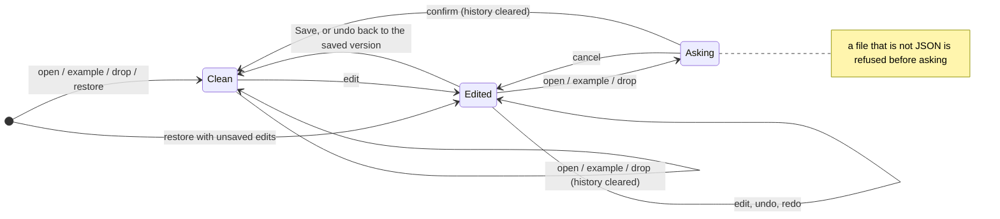
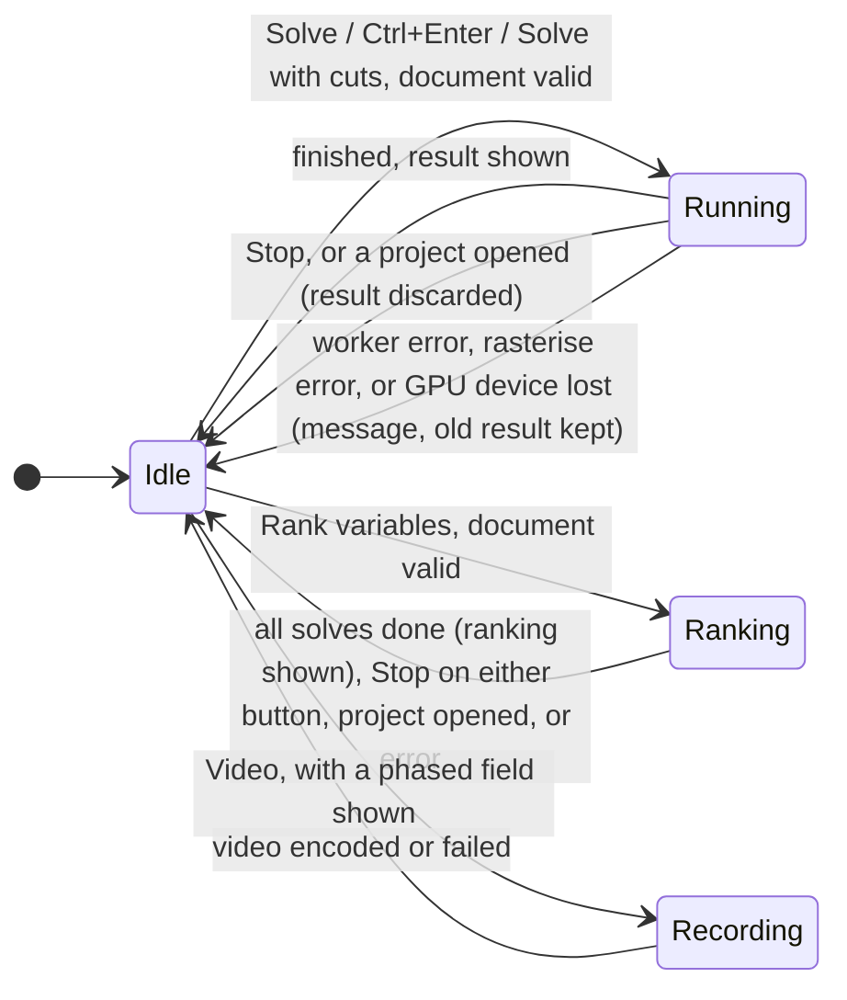
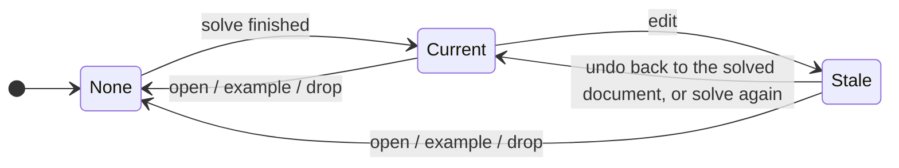
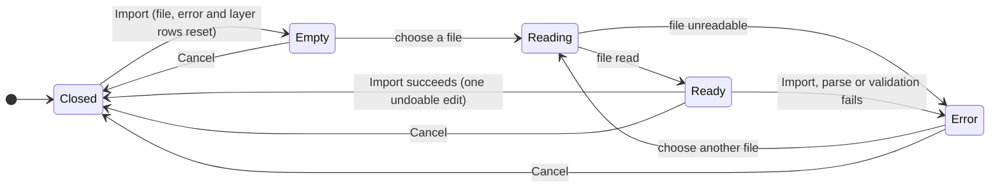

# Workbench states

The workbench has four pieces of state that change on their own schedule: the project document, the
solve, the results, and the import dialog. This page lists each one's states and the events that move
it, so a change to `src/workbench/` can be checked against them. Tests:
`tests/workbench_document.test.ts` (document), `tests/workbench_device_loss.test.ts` (GPU loss),
`tests/workbench_solve.test.ts` (solve).

## Project document

`ProjectStore` (`store.ts`) holds one JSON document. Two flags describe it: whether it parses as a
project (`validation.error`) and whether it differs from the version last opened or saved (`dirty`).

- A valid document can still have a port off copper. The status line then shows a caution and the
  console names the port once per change of the problem; Solve stays enabled.
- Validity is independent of the above. An invalid document can be edited, undone and saved, but not
  solved. The views keep showing the last valid version (`store.lastValid`).
- A drop while the import dialog is open goes to the dialog's file field only; it never opens a project.
- Every change is written to `localStorage` with the saved version beside it, so a reload restores
  the same Clean or Edited state. `?fresh` restores it too, then opens the example through the same
  question. If the write fails, the old copy is removed, a warning says so once, and leaving the page
  while Edited asks first. An unreadable copy is reported and the example opens.
- Save counts as done when the download starts; the browser does not report whether the file was kept.

## Solve

`main.ts` keeps `solving` (the running solve or null) and `result` (the last finished one). A solve runs
in a fresh worker (`solve_client.ts`); Stop terminates the worker, so there is no separate stopping state.

`solving` holds the running solve or the sensitivity ranking (`ranking` says which), so the two never
share the GPU. While ranking, both Solve and Rank variables read Stop. The ranking never replaces
`result`; it is shown on the Sensitivity tab, marked as for the earlier version when the project
changed while it ran.

Recording (`recording` in `main.ts`) holds every control that could start a solve, open or import a
project, or change the field while the video is encoded (Solve, Rank variables, Import, Undo and Redo,
their shortcuts included), then restores each and re-checks validity. Video refuses to start while a
solve or ranking runs (a result landing mid-recording would swap the field), and a project dropped on
the page meanwhile is not opened. An edit typed in the inspector still applies and redraws the board
in the frames that follow.

"Solve with cuts" is disabled while anything runs: it starts a solve and must never act as Stop.

- Solve is disabled while the document is invalid, except as Stop while a solve runs.
- Reloading or closing the tab during a solve asks first. A crash cannot ask; it is reported at the
  next start instead: a running solve is recorded in the tab's `sessionStorage`, and finding it at
  start-up means it did not finish. (A tab duplicated mid-solve copies that record and reports a solve
  the original tab is still running.) Results only ever come from a finished solve, so nothing partial
  is shown.
- Laptop sleep is not handled specially. If the GPU is reset on resume, the solve ends with the
  device-lost message; otherwise it carries on.
- Ctrl+Enter does nothing while a solve runs; only the button stops it.
- Edits during a solve are allowed. The result is still shown when it lands, marked stale.
- GPU device lost: `failOnDeviceLoss` (`solve.ts`) races every GPU wait against `device.lost`, so a
  driver reset ends the solve with a message instead of leaving it running forever.
- WebGPU cannot allocate the grid: the solve fails with a message that suggests "CPU only". There is
  no silent fallback to the CPU.

## Results

`result.projectText` is the exact text that was solved; the page compares it with the document after
every change. With no result, the field buttons and the lobe toggle are disabled, and the field view
returns to "No field". A result tab that the result can't fill is marked off with `aria-disabled`
rather than `disabled`, so it can still be clicked, tapped or reached with the arrow keys: that shows
why it is off for a few seconds, over the view, without leaving the open tab.

## Import dialog

Choosing a second file while the first is still being read keeps only the later one. Import during a
solve is an ordinary edit: the solve continues and its result is marked stale.
